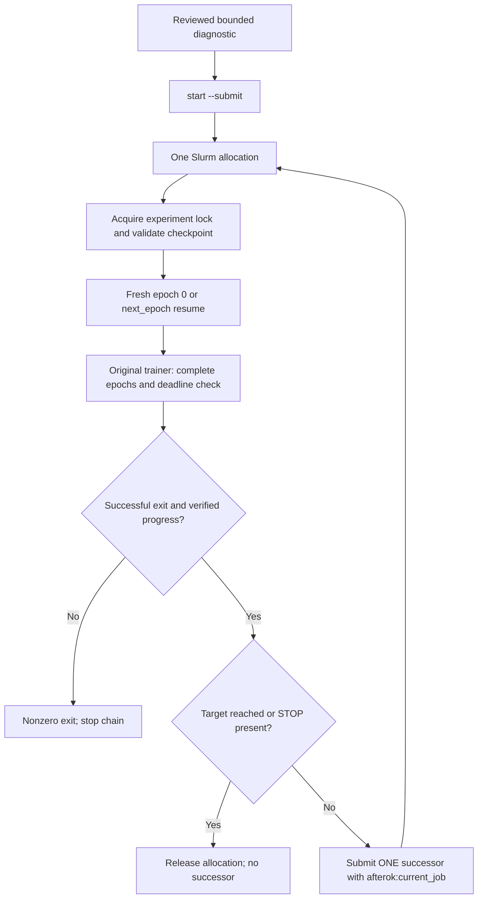

# CET training across Shenkar allocations

This change builds on the working server training code. It does not run preprocessing, change CET mathematics, or submit jobs during implementation. `tamf_cet_001` starts from newly initialized generator weights. It does not depend on the old experiment folder, which the user reports has already been removed, or read/overwrite any baseline checkpoints that remain.

## Reconciliation and verified starting point

On 2026-10-15, `git fetch origin` found:

| Reference | Commit | Finding |
|---|---|---|
| `origin/dev` | `c1b5bee` | Original preprocessing/checkpoint work |
| `origin/server-training-fixes` | `8341977` | Server configuration and additional fixes |
| Local `dev` | `f32d7cf` | Already merges the server branch; identical tracked tree to `8341977` |
| New development branch | `research/cet-slurm-automation` | Created from that merge; no second merge or overwrite needed |

The pre-existing remote named `ntg7creation` was preserved; `origin` was added for the same GitHub repository. No commit or push was made. The pre-existing untracked contents inside `thirdparty/chamfer_distance` were left alone.

The preserved server files include `util/training_state.py` (including handling `None` asset paths), both `config/shenkar_generator*.yml` files, `full_train.sh`, `smoke_train.sbatch`, and `smoke_test/`. A few small historical smoke logs are already tracked on the server branch. This change ignores future smoke TensorBoard/log outputs but does not remove existing tracked files or rewrite history.

The tracked `full_train.sh` is **not** a complete recipe for the reported `tamf_train_003`: it uses raw data, batch 1, a job-specific experiment name, and the 0.1 smoke overlay. The new controller instead uses the server's full cached configuration (batch 4), a stable experiment ID, and complete resume state. Confirm the saved `tamf_train_003` session configuration when assessing a fair baseline comparison.

## What was already working

| Capability | Verified source |
|---|---|
| Cache reuse and disabled validation/test loading | `src/oakink2_tamf/dataset/training_data.py:54`, `build_datasets` |
| Virtual reverse augmentation, original samples then reversed samples | `dataset/training_data.py:31`, `ReverseSegmentView` |
| Complete epoch checkpoints; immutable checkpoint and SHA-256 manifest | `util/training_state.py:118`, `save_checkpoint` |
| Model, AdamW, scheduler, epoch, global updates, Python/NumPy/Torch/CUDA RNG, loader RNG restored | `util/training_state.py:136`, `restore_checkpoint` |
| Objective/data/assets/code compatibility checked on resume | `util/training_state.py:38`, `make_signature` |
| Conservative next-epoch estimate and shutdown reserve | `util/training_state.py:201`, `stop_at_boundary` |
| Parent `SIGUSR1` handler requests stopping after a full epoch | `launch/train.py`, `main` |
| Frozen CLIP recreated, rather than stored in every checkpoint | `util/training_state.py:121` |

`num_epoch` means the **total epoch target**. After completing epoch index 1, `next_epoch=2`: two complete epochs, next execution begins at index 2. Partial epochs are never checkpointed. If killed mid-epoch, restart repeats only that unfinished epoch from the last complete checkpoint.

No checkpoint-format or resume algorithm changes were needed. Normal training saves every epoch in this workflow (`record_freq=1`), also retaining the original legacy weight exports. This consumes disk space; monitor capacity instead of deleting previous checkpoints automatically.

## CET objective and gradients

The existing loss is retained:

\[
L = L_{\mathrm{diffusion}} + \sum_{k} w_k L_k + 0.05 L_{\mathrm{CET}},\quad
k\in\{\mathrm{rec\_joint,rec\_vert,edge\_len,dist\_h,dist\_o}\}.
\]

`InteractionSegmentExtraLoss.forward` adds `weighted_cet` at `model/interaction_segment_extra_loss.py:209`. `launch/train.py:476` calls the diffusion callback, adds the auxiliary loss, then backpropagates. These computations are unchanged. The only launcher additions are TensorBoard `total_loss` and `epoch` scalars.

`model/loss/cet.py:88`, `local_flexion_angles`, extracts `[L,15]` signed anatomical XYZ Euler bend-Z angles from `[L,99]` motion:

1. Skip translation `[0:3]` and the root's 6D rotation `[3:9]`.
2. Decode `[9:99]` into 15 **parent-local** rotation matrices.
3. Change each local rotation to its fixed MANO anatomical frame, `A.T @ R_local @ A`.
4. Extract `atan2(-R[0,1], R[0,0])`, matching the standalone evaluator's signed bend convention.

This is a particular anatomical Euler component, not the rotation magnitude or an arbitrary joint-position angle. Left and right hands use their respective MANO templates. Existing parity tests compare the result with both the evaluator and manotorch. Global wrist rotation does not enter CET.

`hard_dtw_path` (`cet.py:40`) minimizes cumulative mean joint L1 cost using a shared hard alignment path and normalized-time band `rho=0.1`. Valid `frame_id` values define normalized sequence-order time, including reversed segments. `CETLoss.forward` excludes padded frames using the nonempty prefix mask, aligns detached float64 CPU copies, and scores selected pairs on the **original connected PyTorch angle tensors**:

\[
L_{\mathrm{CET}}=\frac1B\sum_{i=1}^B
\frac{1}{15|P_i|}\sum_{(a,b)\in P_i}\sum_{j=1}^{15}
|\theta^{pred}_{i,a,j}-\theta^{GT}_{i,b,j}|.
\]

Gradients flow through selected L1 differences, Euler extraction, 6D decoding, predicted clean motion, and the generator. There is no gradient through discrete path selection; GT angles are detached. This is piecewise differentiable hard-DTW supervision. No soft-DTW or circular error substitution was introduced.

The original five geometric losses sum sample contributions across the local batch. Diffusion and CET average across that batch; CET is also normalized by joints and aligned pairs. Keep batch 4 fixed when interpreting the coefficient. Multiplying CET by batch size would change the established definition and has not been done.

At the callback, all required fields are present: `mask [B,T]`, `pose_repr [B,T,99]`, `frame_id` (valid-frame lists), and `hand_side` (strings). `map_copy_select_to` moves selected tensors to the GPU while preserving these lists. The diagnostic checks this contract before initializing the model.

With `cet_weight=0`, the original CET implementation creates no CET module and adds no zero tensor to the legacy graph. The existing numerical and gradient equivalence tests pass. Registered defaults remain zero; only `config/cet_experiment.yml` enables the candidate.

### Scale and angle branches

The inherited `smoke_test/cet_local_20261015_033709/results.json` contains **one sample, one measured step, no warmup, coefficient 0.1**: raw CET `1.4764` rad, weighted CET `0.1476`, total loss `2.3454`. It also records predicted branch-crossing rate `0.0398`, aligned error above pi rate `0.0641`, and mean non-circular excess `0.0637` rad. This shows why branch diagnostics matter; it is not evidence for batch-4 L4 timing or the final coefficient. Its negative reported overhead is dominated by a cold baseline step and must not be used for scheduling.

Keep coefficient 0.05 until the new diagnostic is reviewed. Inspect raw CET, `cet_weighted`, `original_total_loss`, and `cet_fraction_of_original` across timesteps 0, 500, and 999. Loss magnitude alone does not determine gradient influence; the diagnostic also isolates CET-only generator gradients. A frequent branch problem needs a separately reviewed mathematical decision, not an automatic coefficient or formula change.

## Allocation controller

`script/slurm/cet_jobs.py` owns orchestration; `cet_train.sbatch` activates the **existing** Conda environment and executes it. The batch script receives absolute paths explicitly because Slurm runs a spool copy of the script.



Defaults reproduce the tracked working resource request: partition `gpu`, GRES `shard:1`, 2 CPUs, 16 GB RAM. The requested allocation is now `04:30:00`, internal trainer deadline `15600` seconds. These are requests, not a claim that current Shenkar policy permits them. Batch size 4, workers 2, full training split, reverse augmentation, geometry conditioning, and original loss coefficients come from the working setup.

Safety properties:

- First submission needs a matching bounded diagnostic report proving finite, nonzero CET and CET-only generator gradients. It checks batch 4, source/config identity, cache path/stat, architecture, loss coefficients, and DTW window. Review performance numbers yourself; the controller does not choose an acceptable overhead threshold for you.
- Dry-run is the default; `--submit` is required to call Slurm.
- No preprocessing fallback exists in the controller. Missing cache means failure. The trainer validates cache contents and uses an existing legacy cache with its existing warning if it lacks a manifest; this workflow does not silently regenerate or adopt it.
- State/logs live in `common/cet_jobs/<experiment>/`; generator checkpoints/logs live in `common/train/<experiment>/`. Both are ignored by Git.
- A Linux advisory lock is held throughout training. Starting a second controller fails. Queue inspection also prevents a duplicate pending job. Do not manually launch an independent trainer against the same experiment directory.
- A successor is submitted only after successful trainer exit and an advancing, checksummed complete checkpoint with model/optimizer/scheduler/RNG state. The trainer then performs its own strict restore checks. Do not use legacy `model_*.pt` files as complete resume state.
- `afterok` prevents execution if the predecessor fails; `--kill-on-invalid-dep=yes` avoids an indefinitely stranded dependent job. No successor is submitted after a trainer crash or zero progress. No login-node loop is needed. See [official sbatch dependency documentation](https://slurm.schedmd.com/sbatch.html#OPT_dependency).
- `--no-requeue` avoids blindly repeating an allocation after a controller restart. Explicit `start --submit` resumes safely from the latest complete checkpoint after you inspect a failure.
- The code/config fingerprint is frozen across allocations. Changing source/objective requires review; keep the checkout unchanged during the chain. Target epochs can increase without resetting state or scheduler.
- Only one future job is submitted at a time, and none after the target. The allocation safety cap defaults to the epoch target (at least one complete epoch must advance per successful allocation). Increase it explicitly after investigating failures if necessary.
- Slurm sends `B:USR1` 600 seconds before timeout. The controller forwards it to the existing trainer handler. A signal cannot make an unfinished 71-minute epoch fit in ten minutes: normal safety comes from the trainer's predictive boundary check. Verify that even the **first CET epoch**, including initialization and checkpoint overhead, fits comfortably in an allocation. If an epoch no longer fits, stop and review limits; this workflow cannot save partial epochs.

## Server validation and commands

The CLI and synthetic tests were exercised locally in WSL. Commands involving real cache/assets, Conda paths, scheduler access, cluster policy, full generator training, and L4 measurements still require Shenkar validation. **None of the following Slurm submissions was executed during implementation.**

### 1. Review and synchronize source only

Review the development branch in GitKraken, commit/push the selected source/config/test/documentation changes to `research/cet-slurm-automation`, then on Shenkar:

```bash
cd ~/Desktop/GPU_access_folder/OakInk2-TaMF
git status --short
git fetch origin
git log --oneline HEAD..origin/research/cet-slurm-automation
git diff HEAD...origin/research/cet-slurm-automation -- src config script
```

If the server has new uncommitted work, preserve it on a separate server branch first; do not reset or blindly checkout over it. Once clean, either switch to the reviewed fetched branch or merge it into a new server integration branch and resolve any conflicts. Keep datasets, assets, cache, and old checkpoints on the server. No data transfer through Git is needed. Inspect submodules with `git submodule status`; do not replace working installed dependencies blindly.

### 2. Verify policy and existing paths

```bash
cd ~/Desktop/GPU_access_folder/OakInk2-TaMF
source /opt/sw/miniforge3/etc/profile.d/conda.sh
conda activate oakink2-tamf
export DATA_ROOT="$HOME/Desktop/GPU_access_folder/OakInk2-data"
export TRAIN_CACHE="$PWD/common/save_cache_dict/main/cache/train.pkl"
test -f "$TRAIN_CACHE"
test -d "$DATA_ROOT/anno_preview"
git rev-parse HEAD
python -c 'import torch; print(torch.__version__)'
sinfo -p gpu -o '%P %l %G %m %c %a'
scontrol show partition gpu
sacctmgr show assoc where user="$USER"
sacctmgr show qos
```

Confirm 4.5-hour wall time, account/QOS requirements, shard allocation, memory, CPU count, and that batch jobs may call `sbatch` from compute nodes. `sacctmgr` visibility may be restricted; ask the administrator if necessary. Verify `flock` works on the shared project filesystem and the controller state is visible from every compute node. The resource overrides are `--partition`, `--gres`, `--mem`, `--conda-base`, `--conda-env`, `--data-root`, and `--cache` on the **first** `start`; existing workflows retain persisted settings. Rejected scheduler submission leaves an ambiguity marker intentionally; follow failure recovery below.

### 3. Run the bounded real-generator diagnostic in an approved GPU allocation

This explicitly performs two warmup and six measured optimizer steps **per arm** on four resident samples, then exits. It never saves training checkpoints, samples motions, or changes the cache. Loading a pickle still materializes the source cache, so request sufficient CPU RAM even though only four samples reach the model. Select representative long left/right-hand and object-count examples; the default four indices are only an initial check. Reverse-segment correctness is covered by unit tests; confirm representative reversed sequences in training logs as well.

```bash
python -m script.debug.smoke_train_cet \
  --cache "$TRAIN_CACHE" --data-prefix "$DATA_ROOT" \
  --sample-indices 0 1 2 3 --check-inputs-only

python -m script.debug.smoke_train_cet \
  --cache "$TRAIN_CACHE" --data-prefix "$DATA_ROOT" \
  --sample-indices 0 1 2 3 \
  --model-config config/shenkar_generator_full.yml \
  --loss-config config/shenkar_generator_full.yml \
  --cet-config config/cet_experiment.yml --cet-weight 0.05 \
  --warmup-steps 2 --steps 6 --check-cet-grad --profile-cet \
  --output common/cet_diagnostics/tamf_cet_001_candidate
```

Choose a new output directory if it already exists. The gradient probe uses `autograd.grad` with graph retention, checks finite positive norm, and does not populate `.grad`; ordinary total backward still follows. Its first warmup is excluded from measured timing and peak allocated GPU memory. The report contains both arms' timings, peak allocated/reserved GPU bytes, CPU high-water RSS, loss ratios, and angle-branch diagnostics. CPU RSS is cumulative, includes cache-loading memory, and is not a CET-only memory delta. GPU reserved memory can retain earlier allocations. Profiling synchronizes CUDA and adds overhead; resident-batch step timing does not measure DataLoader throughput or full epoch time. Review `nvidia-smi`, `sstat`, and the first full epoch before trusting scheduling projections.

### 4. Validate actual save/resume and two-job chaining on a tiny cache

Local tests already simulate all controller transitions and run actual checkpoint restoration on tiny CPU models. Server validation must also use the real generator/Slurm. Reuse an existing verified tiny training cache if available. Otherwise the existing helper can select four segments from an existing **manifest-verified** training cache, without raw preprocessing:

```bash
python -m script.debug.smoke_cached_training --prepare-only \
  --source-cache "$TRAIN_CACHE" --sample-indices 0 1 2 3 \
  --cache common/cet_diagnostics/chain_canary/train.pkl

python - <<'PY'
import json
from pathlib import Path
p = Path('common/cet_diagnostics/chain_canary')
metadata = json.loads((p / 'train.pkl.manifest.json').read_text())
# Exclusive creation: preserve an existing split file.
with (p / 'train.txt').open('x') as stream:
    stream.write('\n'.join(metadata['sequence_keys']) + '\n')
PY
```

Do not rerun preparation over an existing subset. If the full working cache is legacy and lacks a manifest, this helper deliberately refuses it: do not regenerate the full cache or invent provenance. Inspect/reuse a trusted compatible existing subset or review legacy-cache adoption separately.

Run the diagnostic from step 3 on this tiny cache (same full architecture/loss configs, four samples, new output `common/cet_diagnostics/chain_canary/diagnostic`). Then:

```bash
python script/slurm/cet_jobs.py start --experiment tamf_cet_chain_smoke_001 \
  --target 2 --epochs-per-allocation 1 \
  --cache common/cet_diagnostics/chain_canary/train.pkl \
  --split-file common/cet_diagnostics/chain_canary/train.txt --data-root "$DATA_ROOT" \
  --diagnostic-report common/cet_diagnostics/chain_canary/diagnostic/results.json --dry-run

# Only after reviewing policy/resources and diagnostic:
python script/slurm/cet_jobs.py start --experiment tamf_cet_chain_smoke_001 \
  --target 2 --epochs-per-allocation 1 \
  --cache common/cet_diagnostics/chain_canary/train.pkl \
  --split-file common/cet_diagnostics/chain_canary/train.txt --data-root "$DATA_ROOT" \
  --diagnostic-report common/cet_diagnostics/chain_canary/diagnostic/results.json --submit
```

The optional epoch cap forces two allocations for this canary only; production remains time-based. Verify first checkpoint `next_epoch=1`, the successor dependency `afterok:<first ID>`, second log `Resumed ... at epoch 1`, final `next_epoch=2`, advancing optimizer/scheduler/update state, and no third job. Also test `stop`, a nonzero trainer failure, and an interrupted checkpoint publication in an isolated canary before relying on long automation. Do not deliberately corrupt production checkpoints.

### 5. Launch the production candidate from epoch 0

After validating the **full-cache** diagnostic and canary, review the dry run:

```bash
python script/slurm/cet_jobs.py start --experiment tamf_cet_001 --target 30 \
  --data-root "$DATA_ROOT" --cache "$TRAIN_CACHE" \
  --diagnostic-report common/cet_diagnostics/tamf_cet_001_candidate/results.json --dry-run
```

The single submission command is:

```bash
python script/slurm/cet_jobs.py start --experiment tamf_cet_001 --target 30 \
  --data-root "$DATA_ROOT" --cache "$TRAIN_CACHE" \
  --diagnostic-report common/cet_diagnostics/tamf_cet_001_candidate/results.json --submit
```

It queues one job, then each successful allocation queues its own dependent successor. No assumption of three epochs per allocation is made. Epoch index 29 completes the 30-epoch target. Fresh command lines have **no** reload/resume flag; no baseline weights are selected. Later workers select this experiment's latest verified complete state explicitly.

### 6. Monitor, stop, resume, extend

```bash
python script/slurm/cet_jobs.py status
squeue -u "$USER" -o '%.18i %.32j %.12T %.10M %.10l %R'
sacct -j JOB_ID --format=JobID,State,ExitCode,Elapsed,MaxRSS,ReqMem,AllocTRES
sstat -j JOB_ID.batch --format=JobID,AveRSS,MaxRSS
tail -f common/cet_jobs/tamf_cet_001/logs/allocation-JOB_ID.log
tensorboard --logdir common/train/tamf_cet_001/summary
df -h common

python script/slurm/cet_jobs.py stop

# Once the running job has finished and no job remains active/pending:
python script/slurm/cet_jobs.py start --experiment tamf_cet_001 --target 30 --submit

# After reaching 30, or after safely stopping the chain:
python script/slurm/cet_jobs.py start --experiment tamf_cet_001 --target 100 --dry-run
python script/slurm/cet_jobs.py start --experiment tamf_cet_001 --target 100 --submit
```

Replace the target with 400 later. Do not reduce a persisted target. To extend while training is running, first stop cleanly, wait for completion, then increase it. Settings including cache, data root, resources, and optional canary epoch cap remain the original persisted settings. Use a separate production experiment, not the canary state.

`status` shows live Slurm IDs/states/dependencies, latest verified checkpoint/next epoch, latest total/raw/weighted CET loss, LR, branch diagnostics, allocation history, and completed training-process hours. TensorBoard values are the latest logged batch, not epoch averages. `epoch` is the most recently concluded zero-based epoch; `running.next_epoch` identifies the allocation's first epoch, not continuously updated progress. Read the log/progress bar for the currently running epoch. Checkpoint epoch counters are authoritative.

Training-process wall time excludes queue time and includes initialization, loading, optimizer steps, and checkpointing. It is not CUDA kernel time. Add current allocation time from `running.started_at` or inspect `sacct` for total allocated GPU wall time. A SIGKILL can prevent the controller from recording that allocation's duration; use Slurm accounting to recover it.

`stop` writes a persistent STOP marker, cancels pending jobs, and sends batch `USR1` to running jobs. It requests a complete-epoch stop; it is not an immediate kill. Slurm's wall time remains the hard limit. Emergency `scancel JOB_ID` can discard the unfinished epoch; it preserves prior complete checkpoints. An explicit subsequent `start --submit` clears STOP after queue checks and resumes.

### Failure recovery

On trainer failure, inspect the allocation log and `sacct` before explicitly restarting. No successor is submitted. `state.json` may show a stale running record after SIGKILL; the live queue and verified checkpoint determine reality. An incomplete newest checkpoint is skipped if an earlier complete one exists; a nonempty experiment with no complete checkpoint fails closed rather than starting over. Preserve that failed experiment and use a new experiment ID after diagnosing it.

If `submission_pending=true`, the controller may have died between submission and recording its job ID, or Slurm rejected the request. Automatic retry is deliberately blocked. Inspect `squeue -u "$USER"`, job name `cet-<experiment>`, accounting, and logs. Cancel/finish any orphan allocation before making a reviewed repair to this JSON bookkeeping. Never blindly clear the flag while a job could still exist. No checkpoint repair or deletion is required. Verify compute-node submission policy before relying on self-chaining.

## Local verification and remaining server work

Local WSL environment: Python 3.10.21, PyTorch 1.13.0+cu116. Server-reported environment: Python 3.10.21, PyTorch 2.0.1+cu118. Rerun lightweight tests in the server environment before long training:

```bash
CUDA_VISIBLE_DEVICES='' OMP_NUM_THREADS=1 MKL_NUM_THREADS=1 \
  python -B -m unittest discover -s tests -v
PYTHONPATH=tests OMP_NUM_THREADS=1 MKL_NUM_THREADS=1 \
  python -B -m unittest test_cet_loss.CETGradientTests.test_cuda_score_parity_and_finite_gradients -v
```

Tests cover mathematical/evaluator parity, global invariance, left/right MANO conventions, padding, 160-frame gradients, branch diagnostics, original zero-weight objective and gradients, actual tiny CPU launcher/cache/resume behavior, two-rank RNG/checkpoint failure propagation, and mocked Slurm chain/error/target/lock/stop behavior. They do not train the actual TaMF generator.

Local results: the integrated CPU suite ran 82 tests: 81 passed, one CUDA-only test skipped. That CUDA test then passed separately on the local GPU. No test failures; the dry-run and Bash syntax checks also passed. Real-generator diagnostics and real Slurm continuation remain unexecuted.

Still verify on Shenkar: source checkout and installed editable import location; real cache/split/assets; working baseline session settings; live resource/account/QOS limits; Conda activation; shared-file locking; compute-node `sbatch`; L4 batch-4 CET-only gradients, loss scale, peak RSS/VRAM and step overhead; a complete CET epoch's duration; actual checkpoint restore and two-allocation canary; graceful signal handling; stop after target; and checkpoint disk growth. No actual server measurement is claimed by the local tests.
