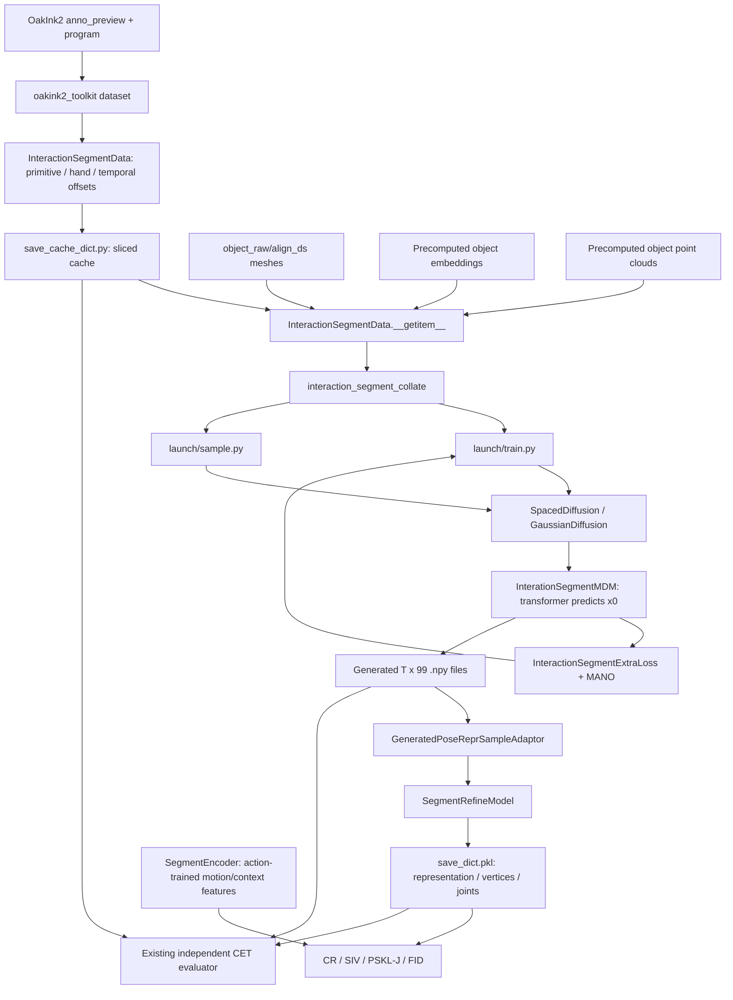

# 01 — Repository map

[Atlas home](README.md) · [Next: data flow](02_data_flow.md)

## Scope and source convention

This atlas describes the **working tree inspected on 2026-10-13**, whose root Git HEAD is `4cb9c461b92c032715374bd252c7179c70a14bde`. References such as `src/oakink2_tamf/launch/train.py:522` are repository-relative paths and one-based source lines. Shapes are derived from executable operations, rather than copied from comments. No training, generation, refinement, metric evaluation, or dataset/cache regeneration was performed.

The checkout already had changes in all four `script/compute_score/compute_score_*.py` files and `src/oakink2_tamf/launch/sample_refine.py`, plus untracked `Scripts/`, `tests/`, notebooks, and a split file. The metric edits select `cuda:0`; the refinement edits also expose its generated-input directory. Those changes are part of the inspected implementation, not changes made for this atlas. Existing CET code is discussed explicitly in [06](06_evaluation.md).

## System boundaries

TaMF's G-stage generates **one hand at a time** from a text description, hand side, hand shape, static object embeddings, and complete object pose sequences. OakInk2 provides the target hand trajectory for supervised diffusion training. The R-stage separately learns to correct a generated hand using hand–object distances. A third model, `SegmentEncoder`, supports the distributional FID evaluation; it is not part of the generator.

## Responsibilities and call relationships

| File | Responsibility | Important classes/functions | Called by |
|---|---|---|---|
| `thirdparty/OakInk2/src/oakink2_toolkit/dataset.py:95` | Resolves dataset directories and metadata; instantiates sequence annotations and primitive task tensors. This is the bridge from OakInk2 files to TaMF. | `OakInk2__Dataset`, `load_complex_task` (288), `instantiate_complex_task` (216), `load_primitive_task` (371), `instantiate_primitive_task` (155), `load_affordance` (510) | `InteractionSegmentData` |
| `thirdparty/OakInk2/src/oakink2_toolkit/program.py:14` | Names repeated primitive instances and handles separate left/right frame ranges. Builds identifiers used in cache keys and evaluation paths. | `suffix_affordance_primitive_segment`, `suffix_transient_primitive_segment` (35), `frame_range_def_enclose` (60) | OakInk2 toolkit dataset |
| `thirdparty/OakInk2/src/oakink2_toolkit/tool.py:5` | Indexes parameter dictionaries and pads hands to the enclosing primitive interval; returns an in-range mask. | `index_param`, `zero_param` (19) | Toolkit primitive instantiation |
| `thirdparty/OakInk2/src/oakink2_toolkit/structure/{complex_task,primitive_task,affordance}.py` | Named containers for sequence graphs, primitive metadata/parameters, and object meshes. These are data structures, not neural models. | `OakInk2__ComplexTask`, `OakInk2__PrimitiveTask`, `OakInk2__Affordance` | Toolkit loader and TaMF dataset |
| `src/oakink2_tamf/dataset/interaction_segment.py:30` | Extracts per-hand primitive motions, synchronously subsamples hands/objects, optionally reverses motion, loads object assets, and creates the 99D/9D representations. | `InteractionSegmentData`, `collect_mano` (39), `collect_obj` (32), `load_dataset` (56), `load_reverse_segment` (160), `__getitem__` (389), `get_cache` (454), `load_cache` (468) | Cache, training, sampling, refinement, metrics |
| `src/oakink2_tamf/dataset/setment_slice.py:10` | Adaptive-stride temporal slicing, one slice per offset, and zero-padding to a common maximum length. Filename really is `setment_slice.py`. | `segment_slice_from_gap`, `SegmentSlice.from_gap` (38) | Dataset's raw-data path |
| `script/save_cache_dict.py:64` | Creates an `InteractionSegmentData` without object embeddings/point clouds, exports its sliced array lists, and writes a pickle when `commit` is enabled. | `main`, `reg_entry` (37) | Manual cache-preparation entry point |
| `src/oakink2_tamf/dataset/collate.py:33` | Stacks fixed-size fields, keeps metadata/geometry as lists, and pads object slots to the maximum count in a batch. | `interaction_segment_collate`, `SegmentCollate` (61) | All training and sampling paths; extended collator for action labels |
| `src/dev_fn/transform/cast.py:76` | Moves selected tensors to device/dtype while retaining every other batch key unchanged. | `map_copy_select_to` | Launchers and extraction helper |
| `src/oakink2_tamf/model/interaction_segment_mdm.py:12` | G-stage denoiser, frozen CLIP text encoder, five prefix tokens, hand/object frame embeddings, temporal transformer, 99D output. Preserve the class's actual spelling. | `InterationSegmentMDM.forward` (134), `encode_text` (111), `ObjectInputProcess` (233), `ObjectEmbedProcess` (251) | `train.py`, `sample.py`, debug generation |
| `src/oakink2_tamf/model/diffusion_util.py:5` | Chooses x0 prediction, MSE loss, fixed variance, and a timestep spacing wrapper. | `create_gaussian_diffusion` | G-stage training and sampling |
| `src/oakink2_tamf/model/diffusion/gaussian_diffusion.py:116` | Implements forward Gaussian corruption, masked training MSE, posterior calculations, and reverse diffusion. Contains other samplers that the main launchers do not select. | `GaussianDiffusion`, `q_sample` (190), `training_losses` (1106), `p_mean_variance` (231), `p_sample` (412), `p_sample_loop` (506) | Diffusion factory via `SpacedDiffusion` |
| `src/oakink2_tamf/model/diffusion/respace.py:60` | Restricts diffusion timesteps and remaps wrapped-model timestep arguments. Current factory retains all 1,000 steps. | `SpacedDiffusion`, `_WrappedModel.__call__` (114), `space_timesteps` (8) | Diffusion factory |
| `src/oakink2_tamf/model/diffusion/resample.py:42` | Samples training diffusion steps with importance weights. The launcher selects uniform sampling. | `ScheduleSampler.sample`, `UniformSampler` (61), `create_named_schedule_sampler` (8) | `train.run` |
| `src/oakink2_tamf/model/interaction_segment_extra_loss.py:18` | Decodes predicted/GT 99D motion through MANO and computes reconstruction and interaction losses. | `InteractionSegmentExtraLoss.forward` (85), `recover_mano_from_pose_repr` (65) | Diffusion's `loss_callback` in `train.py` |
| `src/oakink2_tamf/model/loss/chamfer_distance.py:4` | Computes nearest-point distances, adding signs from nearest hand normals for object-to-hand distances. | `point2point_signed` | G losses, R features/loss preparation |
| `thirdparty/chamfer_distance/chamfer_distance/chamfer_distance.py:65` | This checkout's Chamfer wrapper uses PyTorch3D `knn_points` in both directions (147–162), returning squared distances and nearest-neighbor indices; TaMF gathers points and recomputes Euclidean distances in Torch. | `ChamferDistance.forward` (66) | `point2point_signed` |
| `src/oakink2_tamf/launch/train.py:308` | Initializes data, DDP, model/loss, diffusion, optimizer; performs gradient steps, logs losses, saves checkpoints. | `run`, `main` (662), `summary_extra_loss` (292) | `script/train.sh:3` |
| `src/oakink2_tamf/launch/sample.py:146` | Loads a cached sample and G checkpoint, samples from noise with complete conditioning, saves numeric-index `.npy` motion files. | `sample_worker`, `main` (242) | `script/sample.sh:33` |
| `src/oakink2_tamf/dataset/pose_repr_sample.py:18` | Attaches existing G outputs to GT samples for R; also provides noise-perturbed GT and identity adapters. | `GeneratedPoseReprSampleAdaptor`, `GuassianPerturbSampleAdaptor` (55), `IdentitySampleAdaptor` (96) | R training/sampling, encoder training |
| `src/oakink2_tamf/model/segment_refine_model.py:21` | R-stage residual transformer combines generated hand, object trajectory, and per-vertex hand–object distance; returns refined motion and geometry. | `SegmentRefineModel.forward` (170), `batch_recover_mano_from_pose_repr` (107), `multi_object_h2o_dist` (142) | `train_refine.py`, `sample_refine.py`, extraction helper |
| `src/oakink2_tamf/model/segment_refine_model_loss.py:18` | R-stage joint/weighted-vertex/distance losses, averaged over the batch. No diffusion objective. | `SegmentRefineModelLoss.forward` (35) | `train_refine.run` |
| `src/oakink2_tamf/launch/train_refine.py:325` | Trains R on a concatenation of saved G motions and noisy GT motions. | `run`, `main` (666) | `script/train_refine.sh` |
| `src/oakink2_tamf/launch/sample_refine.py:139` | Refines saved G samples, selects first occurrence of each primitive/hand key, reconstructs MANO output, saves geometry and motion metadata. | `main` | `script/sample_refine.sh` |
| `src/oakink2_tamf/model/extract_sample.py:7` | In-memory G→R helper; a second helper constructs a per-hand conditioning sample from a bimanual record. | `extract_refined_sample`, `extract_refined_sample_bihand` (44) | Callable utility; no production caller identified in the inspected main launchers |
| `src/oakink2_tamf/dataset/action_adapter.py:6` | Assigns one of 69 action labels from the primitive identifier for encoder training/evaluation. | `ActionRecognitionAdapter.__getitem__` (28) | `train_encoder.py`, FID |
| `src/oakink2_tamf/model/segment_encoder.py:16` | Encodes hand motion plus shape/side/object context using a final classification token. Supplies FID features. | `SegmentEncoder.forward` (75) | Encoder trainer and FID evaluator |
| `src/oakink2_tamf/model/segment_encoder_loss.py:5` | Cross entropy and action recognition accuracy. | `SegmentEncoderLoss.forward` (10) | `train_encoder.py` |
| `src/oakink2_tamf/launch/train_encoder.py:309` | Trains the motion/context action encoder. Separate from G and R. | `run`, `main` (672) | `script/train_encoder.sh` |
| `script/compute_score/compute_score_cr.py:140` | Frame contact: minimum generated/reference hand-vertex to transformed object-point distance; threshold 0.005. | `contact_min_cdist`, `transf_merge_obj_pointcloud` (123), `main` (152) | Standalone evaluator |
| `script/compute_score/compute_score_siv.py:128` | Samples object interior grids inside the closed hand mesh to estimate intersection volume. | `solid_intersection_volume`, `main` (158) | Standalone evaluator; `sdf_util.process_sdf` |
| `script/compute_score/compute_score_psklj.py:154` | Joint second-difference FFT power spectra and two directional distributional KL scores. | `main` | Standalone evaluator |
| `script/compute_score/compute_score_fid.py:142` | Gaussian Fréchet distance of learned encoder features from GT and generated/refined motions with shared object context. | `calculate_frechet_distance`, `calculate_activation_statistics` (198), `main` (209) | Standalone evaluator |
| `src/dev_fn/util/sdf_util.py:59`, `src/dev_fn/external/libmesh/inside_mesh.py` | Object SDF grid creation and hand-mesh point-containment queries for SIV. | `process_sdf`, `check_mesh_contains` | SIV evaluator |
| `src/dev_fn/transform/{rotation,rotation_np,transform,transform_np}.py` | Torch/NumPy conversion between real-first quaternions, matrices, 6D rotations, and homogeneous object transforms; applies transforms to points. | `rot6d_to_rotmat` (rotation.py:446), `rotmat_to_rot6d_np` (rotation_np.py:502), `transf_to_tslrot6d_np` (transform_np.py:159) | Dataset, MANO recovery, geometry losses, metrics |
| `thirdparty/manotorch/manotorch/manolayer.py:268` | MANO pose/shape skinning; returns 778 vertices, 21 reordered joints, and 16 absolute transforms. | `ManoLayer.forward`, `skinning_layer` (128), `get_mano_closed_faces` (329) | Losses, refinement, visualization, metrics |
| `thirdparty/manotorch/manotorch/axislayer.py:51` | Anatomy-aligned parent-relative joint rotations. Useful for future curl supervision; not used by baseline G loss. | `AxisLayerFK`, `AxisAdaptiveLayer` (13) | Existing independent CET; potential curl loss |
| `src/oakink2_tamf/model/pointbert/point_encoder.py:103` | Available point encoder implementation, including 768D pooled output for 384D tokens. It is not executed in the G forward pass. | `PointTransformer.forward` (163) | No released-embedding retrieval caller found in this checkout |
| `src/oakink2_tamf/launch/param/{model,loss,mano,base}.py` | Registers accepted configuration keys/defaults and path callbacks. YAML alone cannot create an unregistered parameter. | `reg_model_param`, `reg_loss_param`, `reg_mano_param`, `reg_base_param` | Launchers/cache script |
| `src/dev_fn/upkeep/{ckpt,config,log}.py` | Experiment directories, option snapshots, config substitution/file expansion, logging. | `ckpt_opt` (ckpt.py:142), `cb__decode_file` (config.py:72) | Launchers |
| `src/oakink2_tamf/util/{ddp_util,net_util,state_util,summary_writer}.py` | NCCL setup, per-parameter gradient clipping, checkpoint filtering, distributed scalar logging. | `setup_ddp` (ddp_util.py:17), `clip_gradient` (net_util.py:4), `save_state` (state_util.py:22) | Trainers |
| `script/debug/*.py`, `script/viz_seg.py:85`, `src/dev_fn/viz/control.py` | Manual sample/data visualization and interactive inspection; not automatic evaluation. | Debug `main` functions, `VizControl` | Manual tools |
| `Scripts/evaluate_cet.py:95`, `Scripts/partial_batch.py:49` | Pre-existing local CET and manifest/coverage utilities, distinct from distributed TaMF source. | `curl_from_local_rotations`, `constrained_dtw` (163), `inspect_batch` (255), `coverage` | Local research workflow |

## Configuration and asset map

`script/train.sh:3–14` composes YAML fragments in this order: reverse augmentation, embeddings, point clouds, cache paths, **large** generator architecture, losses, batch size. Its command line disables validation/test sampling, selects four devices, and enables checkpoint writes. Later config files override earlier registered values; explicit command-line options are then applied (`thirdparty/config_reg/src/config_reg/reg.py:253–285`).

| Location | What it supplies and why it matters |
|---|---|
| `config/arch_mdm_l.yml:1` | G: 99 hand features, 9 object pose features, shape 10, object feature 768, latent 512, FFN 2048, eight layers, four heads. |
| `config/arch_mdm.yml:1` | Smaller latent-256/FFN-1024 architecture. Class defaults and the original R wrapper use this size. Do not assume the G wrapper uses this file. |
| `config/arch_refine.yml:1`, `config/2model.yml:1` | R architecture and a nested G/R architecture reference. These files do not automatically configure a launcher that registers only flat `model.*` keys. |
| `config/arch_encoder.yml:1` | Latent-64, two-layer encoder configuration. The FID script's registry defaults are larger, so the matching config/checkpoint is essential. |
| `config/loss_param.yml:3`, `config/loss_param_refine.yml:3` | G auxiliary-loss and R-loss weights and GrabNet weighting/topology assets. |
| `config/cache_dict.yml:1`, `config/cache_dict_all.yml:1` | Cached train/val/test arrays or the all-data cache. Cached contents, not split labels, determine actual samples. |
| `config/data_reverse_segment.yml:1` | Enables training-time addition of time-reversed segments. |
| `config/obj_embedding.yml:1`, `config/obj_pointcloud.yml:1` | Precomputed per-object `.pt` and `.npz` directories under `common/`. |
| `config/refine_sample_param.yml:1` | Saved G input directories for R and Gaussian perturbation range. |
| `config/bs_64.yml:1`, `config/bs_256.yml:1` | Global training batch sizes; the G trainer divides by world size. |
| `asset/split/*.txt` | Sequence-key split lists, expanded by the training/cache configuration callbacks. |
| `asset/mano_v1_2/models/` | MANO left/right parameter files; default registered in `launch/param/mano.py:25`. |
| `asset/grabnet/verts_per_edge.npy`, `asset/grabnet/rhand_weight.npy` | Mesh edge indices and vertex weights used for both hand sides by G losses (`interaction_segment_extra_loss.py:39–42`). |
| `common/save_cache_dict/`, `common/sample/`, `common/sample_refine/`, `common/train/` | Generated caches, G motions, R records, and training artifacts. `ckpt.py:72` derives `common/<program>/<exp_id>` from the working directory. |
| `common/retrieve_obj_embedding/`, `common/retrieve_obj_pointcloud/` | Downloaded static assets consumed by object ID. **No retrieval/preprocessing script producing these released assets was found.** |
| `thirdparty/CLIP/`, `thirdparty/manotorch/`, `thirdparty/OakInk2/`, `thirdparty/config_reg/`, `thirdparty/chamfer_distance/` | Direct functional dependencies. `pyrender` and `chumpy` support visualization/legacy MANO dependencies. `.gitmodules` records their repository origins. |
| `doc/`, `downloads/`, `.cache/`, `tmp/`, `notebooks/` | Illustrations, downloads/caches, metric outputs, and existing research reports; no role as learned G inputs is established by their names alone. |

## What the repository does not establish

The toolkit loads task graphs and scene/recipe metadata, but G consumes only each primitive's description and per-hand selected objects; no graph encoder is called (`interaction_segment.py:72–97`, `interaction_segment_mdm.py:134–174`). RGB/video and SMPL-X are not G inputs, even though the toolkit instantiates SMPL-X parameters. The README requests `object_repair`, but this dataset defaults to `object_raw/align_ds` (`oakink2_toolkit/dataset.py:99–107`).

The presence of PointBERT source and downloaded 768D embeddings does not prove the exact released embedding extraction configuration, normalization, or checkpoint. Likewise, the point-cloud asset's sampling algorithm is unresolved. The verified contract is the loader and the actual small asset headers; see [02](02_data_flow.md).

## Dependency revision snapshot

The root revision alone does not describe vendored behavior. Read-only `git rev-parse HEAD` inspection found these submodule revisions:

| Submodule | Inspected HEAD |
|---|---|
| `thirdparty/OakInk2` | `d2d67539ffb09759fb56c2b8455c6ecfff847692` |
| `thirdparty/manotorch` | `933be97d6fa05c729656669640084251ce644b0a` |
| `thirdparty/CLIP` | `dcba3cb2e2827b402d2701e7e1c7d9fed8a20ef1` |
| `thirdparty/chamfer_distance` | `f86f6f7cadd3aca642704573d1626c67ca2e2846` |
| `thirdparty/config_reg` | `32528784a6c7e5374815ccdc3056f304ac76ee0d` |
| `thirdparty/chumpy` | `51d5afd92a8ded3637553be8cef41f328a1c863a` |
| `thirdparty/pyrender` | `a59963ef890891656fd17c90e12d663233dcaa99` |

The root's Chamfer dirty marker came from existing untracked installation/cache directories. Its inspected source imports PyTorch3D KNN, despite generic references to a separate Chamfer extension in some dependency descriptions. This atlas follows that executable wrapper. Import resolution in the user's activated training environment was not probed, so the installed module path is a remaining environment-provenance check.
