# 02 — Complete data flow

[Atlas home](README.md) · [Previous: repository map](01_repository_map.md) · [Next: generator](03_generator_architecture.md)

## Notation and evidence

`B` is the batch size **on one GPU**, `T=160` the dataset's default padded length, `L_b` its valid length, `N_b` its real object count, and `N=max_b N_b` the collated object count. `P` is a per-object point count (8192 in the inspected asset), `D` the model latent dimension. Tensors are float32 unless noted. Shapes below follow the actual conversions; source comments occasionally say `4×4` where the called rotation conversion returns `3×3`.

The local `data` link resolves under WSL to `../OakInk2/data`. Read-only inspection confirmed `anno_preview`, `program/{program_info,desc_info,pdg,initial_condition_info,task_target.json}`, and `object_raw/{align_ds,obj_desc.json}`. Only small JSON examples and asset serialization headers were read. The 1.50 GB local test cache and raw motion pickles were not deserialized for this investigation; cache/annotation tensor contracts below are verified from their consumers, not a full artifact census.

## Raw file contracts

The sequence token is `seq_key.replace("/", "++")` (`thirdparty/OakInk2/src/oakink2_toolkit/dataset.py:292`).

| Raw source | Fields actually used | Conversion / downstream role |
|---|---|---|
| `data/anno_preview/<seq_token>.pkl` | `mocap_frame_id_list`, `raw_mano`, `obj_list`, `obj_transf`; toolkit also reads `raw_smplx` | `instantiate_complex_task` (dataset.py:216) collects motion in frame-ID order. |
| Annotation `raw_mano[fid]` | Hand-prefixed keys such as `rh__pose_coeffs`, `rh__tsl`, `rh__betas`, likewise `lh__*` | `_collect_mano` (257–274) removes the side prefix and concatenates tensors along time. Downstream expects pose `[F,16,4]`, translation `[F,3]`, shape `[F,10]`. Quaternions are real-first `(w,x,y,z)` (`src/dev_fn/transform/rotation.py:127`). |
| Annotation `obj_transf[obj_id][fid]` | Per-frame object homogeneous transform `[4,4]` | `_collect_obj_transf` (276–285) stacks `[F,4,4]` per object. Applied to canonical object points as `R p + t`. |
| `program/program_info/<token>.json` | Enclosing/per-hand frame ranges, primitive, `obj_list`, `obj_list_lh`, `obj_list_rh`, `interaction_mode` | `_load_primitive_task_from_def` (413–472) creates primitive metadata. The range-key pair can contain `None` for an uninvolved hand. |
| `program/desc_info/<token>.json` | `seg_desc` | The exact primitive text used by G (`dataset.py:441`; `interaction_segment.py:83`). Other language descriptions are not selected here. |
| `program/task_target.json`, `program/pdg/<token>.json`, optional initial-condition JSON | Sequence catalog, execution/graph structure, scene description/recipe | Toolkit reads these to create complex-task objects (dataset.py:111–116, 295–333); G does not consume graph/recipe tensors. |
| `object_raw/obj_desc.json`, `object_raw/align_ds/<obj_id>/*.{obj,ply}` | Object metadata and aligned/downsampled canonical mesh | `load_obj` (dataset.py:24–34) requires exactly one candidate mesh; `load_affordance` and `instantiate_affordance` attach it. |
| `common/retrieve_obj_embedding/main/embedding/<obj_id>.pt` | A CPU-loadable object embedding | `InteractionSegmentData.load_object_embedding` (267–274) converts to float32 NumPy without further normalization. The inspected `C10001.pt` serialization records a float tensor of shape `[768]`, matching G's linear layer. |
| `common/retrieve_obj_pointcloud/main/pointcloud/<obj_id>.npz` | **Only** `point` is loaded | `load_object_pointcloud` (276–283) converts points to float32. `C10001.npz` contains `point`, `point_normal`, `point_color`, each `[8192,3]`; normals/colors are ignored by this loader. |

For a concrete program example, `scene_01__A001++seq__07bb164dc3d3873d6389__2023-04-27-20-45-29.json` contains the key `(None, (966, 5954))`, primitive `grip`, and two right-hand object IDs. Its description is “Grip the content with the tongs from the plate to another plate.” This illustrates separate hand ranges and multi-object selection; it is not evidence that all primitives have this format/length/object count.

## Processing sequence

```mermaid
flowchart LR
    A[Raw annotations + program] --> B[Toolkit complex task]
    B --> C[Primitive task with enclosing range]
    C --> D[Select involved hand and its objects]
    D --> E[Quaternion to rotation matrices]
    D --> F[Object 4 x 4 transforms]
    E --> S[Same stride and offset for pose / translation / shape / objects / frame IDs]
    F --> S
    S --> K[Zero-padded sliced cache lists]
    K --> R[Optional valid-prefix time reversal]
    R --> I[Dataset item: pose_repr T x 99; obj_traj N_b x T x 9]
    AS[Static embedding and point assets] --> I
    I --> COL[Collate B items; pad object slots]
    COL --> DEV[Move selected tensors to GPU]
    DEV --> X[GT hand x0 B x 99 x 1 x T]
    X --> Q[Add noise for training]
    Q --> G[G forward: noisy hand + conditions]
    DEV --> G
    G --> O[Predicted clean hand B x 99 x 1 x T]
```

### 1. Sequence and primitive instantiation

`InteractionSegmentData.load_dataset` calls the toolkit's `load_complex_task` and `load_primitive_task` (`src/oakink2_tamf/dataset/interaction_segment.py:71–76`). The execution path includes named affordance and transient primitives; it is not filtered to only a single action class. Naming functions live in `oakink2_toolkit/program.py:14–53`.

The toolkit indexes primitive motion using the enclosing `[start,end)` frame range, pads either hand to that enclosing range, and provides `lh_in_range_mask`/`rh_in_range_mask` (`dataset.py:163–199`; `tool.py:5–16`). TaMF then iterates `HAND_SIDE`, keeps the hands listed as involved, and **skips a hand if its selected object list is empty** (`interaction_segment.py:79–90`). A bimanual primitive can therefore yield two independent per-hand examples; there is no jointly generated two-hand tensor in this Dataset.

`collect_mano` uses the in-range mask to discard toolkit padding and requires each hand array to have exactly `seg_end-seg_beg` frames (39–54). `collect_obj` uses `seg_beg-task_beg : seg_end-task_beg` to align object motion to that same hand range (32–37). Hand pose quaternions become `[F,16,3,3]` rotation matrices; object motion stays `[F,4,4]` at this stage.

**Index assumption to audit for new datasets:** the toolkit concatenates annotation frames by `mocap_frame_id_list` and subsequently indexes tensors using frame numbers (`dataset.py:257–285`, 167–191). There is no explicit frame-ID→row map here. Correctness relies on the annotation frame numbering matching the indexing convention. A full-dataset check was not run.

### 2. Adaptive temporal slicing, not interpolation

`FPS_MOCAP=120` (`thirdparty/OakInk2/src/oakink2_toolkit/meta.py:4`). Dataset defaults are `target_fps=10`, `slice_min_len=16`, `slice_max_len=160`; nominal gap is integer floor division `120 // 10 = 12` (`interaction_segment.py:285–311`).

For an input primitive of length `F`, `segment_slice_from_gap` (`setment_slice.py:10–35`) uses:

\[
g=\begin{cases}
\lfloor F/16\rfloor & F<16\cdot12\\
\lceil F/160\rceil & F>160\cdot12\\
12 & \text{otherwise.}
\end{cases}
\]

For **every offset** `o=0,...,g-1`, it selects `traj[o::g]`, checks the resulting length is between 16 and 160, and zero-pads to 160. All hand/object/shape/frame arrays are sliced independently with the same length/gap rules (`interaction_segment.py:99–124`), which preserves alignment because their raw lengths agree. Valid frame IDs are retained without padding.

This yields several interleaved views of a primitive, not consecutive cropped windows. It does not interpolate rotations or translations. Short and long primitives change stride, so effective sample rates are not always 10 Hz. For example, a 600-frame primitive at gap 12 produces 12 examples of 50 valid frames; a 2400-frame primitive uses gap 15 and produces 15 examples of 160 frames. If `F<16`, the calculated gap is zero and the function returns no slices; it does not upsample those primitives to the minimum length.

### 3. Cache creation and loading

`script/save_cache_dict.py:90–104` creates a raw-path Dataset, calls `get_cache`, and writes `common/save_cache_dict/<exp_id>/cache/<split_name>.pkl` under the checkpoint path when `commit=True`. It passes `enable_obj_model=True` even though meshes are not serialized by `get_cache`.

The cache schema is parallel lists (`interaction_segment.py:454–480`):

| Cache key suffix after `interaction_segment_` | Per-entry content |
|---|---|
| `info_list` | `(sequence_key, primitive_identifier, hand_side)`; no temporal offset in this tuple |
| `len_list` | Valid frame count `L` |
| `pose_list` | `[160,16,3,3]` rotation matrices, zero tail |
| `tsl_list` | `[160,3]`, zero tail |
| `shape_list` | `[160,10]`, zero tail |
| `hand_side_list`, `text_list` | Side string and primitive description |
| `obj_traj_list` | Dictionary `obj_id → [160,4,4]`, zero tail |
| `frame_id_list` | Python list of `L` original motion-capture frame IDs |

`interaction_object_list` is the union of selected object IDs across the cache. Static meshes, embeddings, and point clouds are loaded separately.

Loading a cache bypasses segmentation/slicing and trusts its arrays. `load_cache` does not filter by `process_range_list`, validate split identity, validate sampling settings, or store schema/version metadata. The toolkit constructor still reads basic program/object metadata (`interaction_segment.py:304`, 314–339). Changing a split flag with the same cache does **not** change the cached population.

### 4. Reverse-segment augmentation

When enabled, `load_reverse_segment` appends one reversed copy of every existing example (160–264). It reverses **only `[:L]`** of hand matrices, translation, shape, and every object's transforms; zero tails remain in place. It reverses the valid frame-ID list. It retains length, text, side, object identities, and the **same `info` key**. Dataset length doubles (`interaction_segment.py:224–252`, 340–357).

This produces synchronized reversed hand/object motion but does not rewrite language. A “pour” or “open” description can therefore accompany reverse physical motion. That is verified augmentation behavior, not a claim of semantic equivalence. The standard G wrapper enables it for training only (`script/train.sh:4`; `train.py:348`); validation/test and the sampling launcher omit it. Refinement and all original metrics select only first `info` occurrences, so appended reversed copies would be discarded by that evaluation policy.

### 5. Dataset representation and collate

`__getitem__` flattens the first **two rows** of each of the 16 rotation matrices into 96 numbers and prepends three translation values (`interaction_segment.py:400–404`; `rotation_np.py:502–518`). There is no mean/std normalization, object-relative coordinate conversion, or mirroring in this code path.

It sorts object IDs, converts each homogeneous transform to `[translation(3), rotation_rows(6)]`, stacks `[N_b,T,9]`, and creates `mask[:L]=1`, `mask[L:]=0` (406–428). The same sorted order selects embeddings, point clouds, and meshes (431–448).

`interaction_segment_collate` stacks fixed-size arrays and zero-pads **object slots**, not time, to `N` (`collate.py:6–58`). `obj_pointcloud`, object mesh arrays, strings, identifiers, and frame IDs remain lists. There is no object-slot validity tensor or trajectory-observation mask. `obj_num` records real counts but the generator does not read it.

## Complete input/output table

“GT” below includes dataset-derived conditions as well as supervised targets. “Inference” distinguishes stock code availability from availability in an application without OakInk2 annotations.

| Variable | Source / meaning | Item → batch shape/type | Transform | GT information? | Inference availability | Model/loss entry |
|---|---|---|---|---|---|---|
| `pose_repr` | Annotated hand translation and 16 MANO rotations | `[T,99] → [B,T,99]` | Quaternion→matrix→two rows; concatenate translation; zero tail | **Training target** | Present in stock sample batch; its **values are not read by G.forward** | Training creates `x_start`; geometry-loss target; sample launcher uses shape only |
| `x_start` / `x0` | Clean target hand | `[B,99,1,T]` | Unsqueeze/permutation of `pose_repr` | Yes | Not used to initialize stock inference | `diffusion.training_losses`, MSE target |
| `noise` / `epsilon` | Sampled Gaussian noise | `[B,99,1,T]` | `randn_like` during training; `randn` initially during inference | No | Generated internally | `q_sample` / reverse sampler |
| `x` / `x_t` | Current noisy/generated hand state | `[B,99,1,T]` | Training corrupts GT at step `t`; inference evolves independent random noise | Derived from GT **during training**; generated at inference | Yes, internally | `InputProcess.forward` |
| `t` / `timesteps` | Diffusion index | `[B]`, integer | Uniform sample in `[0,999]` during training; reverse countdown at inference | No | Generated internally | `TimestepEmbedder` prefix |
| `text` | `program/desc_info` primitive `seg_desc` | String → list of `B` strings | CLIP BPE truncation/padding, frozen text encoder | Dataset annotation in stock workflow | User prompt can replace it | CLIP→linear→text prefix |
| `hand_side` | Primitive's involved hand | `"lh"`/`"rh"` → list length `B` | Fixed indicator latent vector | Dataset metadata | Can be selected by user | Hand-side prefix; side-specific MANO layer |
| `shape` | Annotation `betas` | `[T,10] → [B,T,10]` | Sliced/zero-padded; **unmasked** temporal mean in G | Yes, subject shape | GT in stock workflow; a supplied shape is structurally possible | Shape prefix and MANO reconstruction |
| `obj_list` | Per-hand program object IDs surviving toolkit availability filtering | List of `N_b` strings → list of lists | Sorted lexicographically in each item | Dataset identity selection | Can be supplied; no categorical ID lookup inside G | Asset lookup outside G; actual-object loops in geometry loss/R |
| `obj_num` | `len(obj_list)` | Scalar → `[B]` | Collate integer; training device helper casts selected keys to float32 | Metadata | Available | **Not read by G**; cannot fix padding automatically |
| `obj_traj` | Annotation object transforms aligned with hand segment | `[N_b,T,9] → [B,N,T,9]` | 4×4→translation plus first two rotation rows; zero temporal/slot padding | **Complete GT object motion** | GT in stock workflow; must be supplied to stock forward | `ObjectInputProcess`; also geometry-loss scene transforms |
| `obj_embedding` | Per-ID static `.pt` asset | `[N_b,768] → [B,N,768]` | Float32, stack, slot-pad; no loader normalization | Static object information, not hand target | Available if object asset exists | Mean over objects→linear→object prefix |
| `obj_pointcloud` | `.npz["point"]`, canonical object coordinates | `[N_b,P,3] →` list of `B` arrays | Float32; transformed by GT object pose for losses/R | Static geometry | Needed for selected loss/R paths, **not G.forward** | G auxiliary geometry losses when `use_pc=True`; R distances; CR |
| `obj_verts`, `obj_faces` | `object_raw/align_ds` meshes | Per-object arrays with varying vertex/face count → lists | Loaded without processing; canonical coordinates | Static geometry | Optional to G itself; used by other components | Geometry-loss fallback; SIV mesh/SDF; R fallback |
| `mask` | Valid hand-segment length | `[T] → [B,T]` | Ones then zeros | GT duration metadata | Stock workflow retains it | Diffusion and extra-loss reduction; **not G attention masking** |
| `len` | `L`, valid length | Scalar → `[B]` integer | Kept from slicing | GT duration | Stock workflow retains it | Trimming/metrics; not G.forward |
| `frame_id` | Original mocap indices | List of `L` ints → list of lists | Same stride/offset as motion; reversed if augmented | GT timing | Saved metadata | Alignment/audit/CET; not G.forward |
| `info` | Sequence/primitive/side tuple | Tuple → list of tuples | Repeated across temporal offsets | Metadata | Stock sample selection | Output identity/deduplication; not G.forward |
| `model_output` / predicted `x0` | G estimate of clean hand at sampled noise level | `[B,99,1,T]` | Linear output; `nan_to_num` | Generated prediction | Yes | Diffusion objective/posterior and extra losses |
| G saved motion | Final reverse-diffusion output | `[T,99]` `.npy` | Permute/squeeze; no trimming at save | Generated | Yes | R adapter or independent G evaluation |
| MANO `verts`, `joints` | Decoded prediction plus supplied shape/side | `[T,778,3]`, `[T,21,3]` | 6D→matrix→quaternion→MANO; wrist-center; add translation | Prediction geometry; GT geometry uses target pose | Yes with MANO/shape | Extra losses/R/metrics, not denoiser input |

Sources for batch device/layout preparation are `train.py:512–524`, `sample.py:203–232`, and `cast.py:76–85`. Moving selected keys does not remove the others: text, side, geometry lists, and metadata remain available.

## The key target/condition distinction

Training obtains `x_t` by corrupting the **GT hand** `x_start`; it asks G to estimate that clean hand. G reads `x_t`, `timesteps`, `text`, `hand_side`, `shape`, `obj_embedding`, and `obj_traj`. It never reads the clean `batch["pose_repr"]` in its forward method (`interaction_segment_mdm.py:134–174`). The extra-loss callback does read it, correctly, as supervision.

At inference, the launcher retains a GT sample dictionary for convenience but passes `init_image=None` and `noise=None`; the sampler creates random noise (`sample.py:216–229`; `gaussian_diffusion.py:598–613`). Clean hand values therefore do not seed generation. The complete object trajectory and subject shape still do condition generation, and GT metadata determines the stock output layout/evaluation window. This is conditional hand-motion fulfillment, not joint generation of hand and object trajectories.
