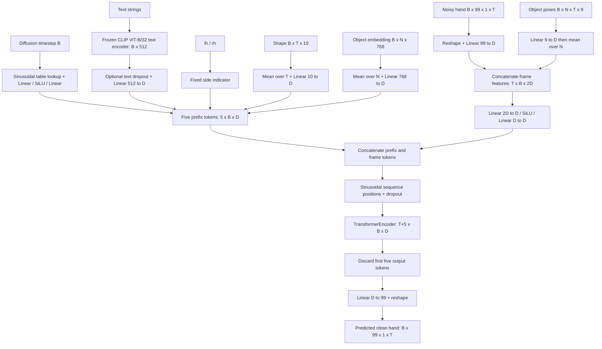

# 03 — G-stage generator architecture

[Atlas home](README.md) · [Previous: data flow](02_data_flow.md) · [Next: training and losses](04_training_and_losses.md)

## What is being diffused

The G-stage is `InterationSegmentMDM`, a conditional **transformer encoder denoiser predicting clean motion x0**. It does not predict noise, joint XYZ directly, or object motion. Diffusion corrupts the Euclidean 99D hand representation and trains the network to reconstruct it (`model/diffusion_util.py:5–31`; `diffusion/gaussian_diffusion.py:1170–1182`). Here and below, paths beginning `model/` abbreviate `src/oakink2_tamf/model/` within explanatory prose; complete references are supplied for key operations.

Each frame's 99 features are:

\[
x_f=[\underbrace{t_x,t_y,t_z}_{3},\underbrace{r_0^{6D},r_1^{6D},\ldots,r_{15}^{6D}}_{96}].
\]

Rotation 0 is the MANO root/global wrist orientation. Rotations 1–15 are parent-relative articulation rotations; MANO multiplies them along each finger's hierarchy (`thirdparty/manotorch/manotorch/manolayer.py:132–133`, 164–198). The 6D encoding consists of the first two **rows**, not columns, of a matrix (`src/dev_fn/transform/rotation.py:470–486`). Translation and rotations are not standardized to a common scale before Gaussian corruption.

`script/train.sh:8` chooses `config/arch_mdm_l.yml`: latent `D=512`, feedforward width 2048, eight transformer layers, four attention heads, dropout 0.1, GELU. The class/config registry defaults are `D=256`, FFN 1024; reading defaults alone would describe the wrong wrapper-selected G architecture (`interaction_segment_mdm.py:13–26`; `launch/param/model.py:18–86`).

## Forward pass in one diagram

The main sequence is `InterationSegmentMDM.forward` at `src/oakink2_tamf/model/interaction_segment_mdm.py:134–174`.

## Five prefix tokens, in exact order

| Position | Input and processing | Output before concatenation | Source |
|---|---|---|---|
| 0 | Diffusion index `timesteps`; lookup `pe[timesteps]`, then linear→SiLU→linear | `[1,B,D]` | `interaction_segment_mdm.py:142`, `TimestepEmbedder.forward:214` |
| 1 | `batch["text"]`; frozen CLIP produces `[B,512]`; optional `mask_cond`, learned linear projection | `[1,B,D]` | Lines 145–148, 111–132 |
| 2 | `batch["hand_side"]`; fixed all-zero right vector, left vector with coordinate 0 equal to 1 | `[1,B,D]` | Lines 150–151, `HandsideProcess:266–288` |
| 3 | `batch["shape"] [B,T,10]`; ordinary mean across **all T frames**, learned linear | `[1,B,D]` | Lines 152–153, `HandShapeProcess:291–303` |
| 4 | `batch["obj_embedding"] [B,N,768]`; ordinary mean across **all N slots**, learned linear | `[1,B,D]` | Lines 155–157, `ObjectEmbedProcess:251–263` |

These tokens are concatenated, not summed into one global context vector. Their order is fixed; sequence position encoding distinguishes them. There is no learned condition-type embedding beyond each branch's own projection/side constant. `torch.nan_to_num` is applied after prefix concatenation (158).

### Language details

`load_and_freeze_clip` uses `clip.load("ViT-B/32", device="cpu", jit=False)`, freezes all parameters, and puts CLIP in evaluation mode (84–97). The overridden `train` keeps CLIP in eval even while the denoiser trains (176–178).

`encode_text` hardcodes a context of 22 tokens: start, up to **20 tokenizer tokens**, and end; it truncates longer descriptions and then pads to CLIP's standard length 77 (111–132). These are BPE tokens, not necessarily 20 words. The output is converted to float and projected from 512 to `D`. The text is encoded on each denoiser call; the main sampler does not cache text features across its 1,000 calls.

`mask_cond` only handles the text vector. Its probability defaults to zero through `kargs.get("cond_mask_prob", 0.0)` (47). Neither `launch/param/model.py` nor the stock constructor calls in `train.py:436–447` / `sample.py:177–188` expose/pass this parameter. Forward explicitly uses `force_mask=False` (146). There is no working stock classifier-free guidance wrapper in the main G launch path. Even if text features were zeroed, the downstream linear layer's bias would remain: “zero CLIP feature” is a particular null-text embedding, not necessarily a zero token.

### Shape details and duration leakage

Shape is supplied, not generated. The prefix uses an unmasked mean of the zero-padded `[T,10]` sequence. If valid shape is constant `beta`, the effective vector is `(L/T) beta`, so changing valid duration changes the prefix even for the same hand shape (`HandShapeProcess.forward:298–303`; `interaction_segment.py:103–104`). MANO reconstruction instead receives per-frame shape. Replacing this pooling with a valid-frame mean would be a behavioral change and should be versioned separately from a curl experiment.

## Framewise hand/object fusion

Let `z_bof` be a 9D object pose and `x_bf` the noisy 99D hand frame. The actual object branch and merger are:

\[
h_{bf}=W_hx_{bf}+b_h,\qquad
o_{bf}=\frac1N\sum_{o=1}^{N}(W_oz_{bof}+b_o),
\]
\[
u_{bf}=W_2\operatorname{SiLU}\left(W_1[h_{bf};o_{bf}]+b_1\right)+b_2.
\]

`InputProcess` permutes `[B,99,1,T]` to `[T,B,99]` and projects to `[T,B,D]` (218–230). `ObjectInputProcess` permutes `[B,N,T,9]` to `[B,T,N,9]`, applies one shared 9→D linear, averages over objects, and permutes to `[T,B,D]` (233–248). `input_merge` maps the concatenated `[T,B,2D]` tensor to `[T,B,D]` (54–58, 161–166).

Objects do **not** become separate prefix tokens or separate per-object temporal tokens. Object ID strings are not embedded categorically. Geometry and poses are pooled in independent branches; the network does not explicitly bind a particular static embedding to its particular trajectory. Because the object-pose projection is linear before pooling, its output equals the projection of the mean raw 9D pose. It should not be interpreted as a physically valid averaged rigid transform.

### Object padding changes conditioning

With `N_b` real objects padded to batch maximum `N`, a zero-padded geometry mean is `sum(real_embeddings)/N`, not `/N_b`. The trajectory branch similarly gives `W_o sum(real_poses)/N + b_o`. Padded zero slots therefore alter the features; their bias contribution survives. The class does not read `obj_num` or `obj_list` (`forward:134–174`). A sample can receive different object conditioning when collated with a different maximum object count, even in eval mode. Stock standalone G sampling uses batch size one, so it has no extra object slots from neighboring samples (`sample.py:206`). This is a code-derived batch-context effect, not a measured performance claim.

## Sequence transformer and outputs

The five prefixes and frame tokens make `[T+5,B,D]`. `PositionalEncoding` adds sinusoidal values indexed by sequence position and applies dropout (181–198). Its source comment says “not used in the final model,” but forward calls it at line 170; executable code takes priority.

The transformer is `nn.TransformerEncoder` built from eight `nn.TransformerEncoderLayer`s in the wrapper-selected config (63–70). No causal mask or `src_key_padding_mask` is supplied. The commented padding-mask fragment at line 171 is not executed. All valid and padded hand/object timesteps can attend to each other and to all prefixes. `batch["mask"]` masks loss reductions only.

The first five output tokens are discarded. `OutputProcess` maps `[T,B,D] → [T,B,99] → [B,99,1,T]` (306–318). `nan_to_num` is applied after the merge and final output (166, 173); it is a numerical replacement, not a validity or missing-data mechanism. No softmax, joint-limit constraint, 6D normalization, or MANO layer is inside the G forward pass.

| Step | Tensor shape, with wrapper `D=512`, default `T=160` |
|---|---|
| Noisy hand | `[B,99,1,160]` |
| Hand frame projection | `[160,B,512]` |
| Projected object poses before pool | `[B,160,N,512]` |
| Pooled object frame features | `[160,B,512]` |
| Concatenated frame features | `[160,B,1024]` |
| Merged frame tokens | `[160,B,512]` |
| Prefixes | `[5,B,512]` |
| Transformer input/output | `[165,B,512]` |
| Retained frame outputs | `[160,B,512]` |
| Predicted clean representation | `[B,99,1,160]` |

## Converting a generated representation to MANO

`InteractionSegmentExtraLoss.recover_mano_from_pose_repr` (`src/oakink2_tamf/model/interaction_segment_extra_loss.py:65–80`) does the same basic decoding used elsewhere:

1. Take translation `pose_repr[:,0:3]`.
2. Reshape `[:,3:99]` to `[T,16,6]`.
3. Gram–Schmidt orthogonalize two rows to obtain `[T,16,3,3]` (`rotation.py:446–467`). Convert to real-first quaternions `[T,16,4]`.
4. Run side-specific `ManoLayer(rot_mode="quat", center_idx=0, use_pca=False, flat_hand_mean=True)` with supplied `[T,10]` betas.
5. Add translation to the wrist-centered vertices and joints.

The third rotation row is the cross product of the two normalized rows. For finite, nondegenerate inputs this projects to a proper rotation. Zero/collinear 6D inputs are degenerate and must not be treated as an identity rotation. A source comment at extra-loss line 70 incorrectly labels the matrix shape `4×4`; the converter returns `3×3`.

MANO supplies 778 mesh vertices and 16 skeletal transforms, then appends five mesh-derived fingertips and reorders joints to 21-joint SNAP order (`manolayer.py:222–240`). The **16 rotation order is different from the 21 XYZ joint order**:

| Finger | MANO local rotation indices | Returned SNAP joint chain, including fingertip |
|---|---|---|
| Thumb | 13,14,15 | 1,2,3,4 |
| Index | 1,2,3 | 5,6,7,8 |
| Middle | 4,5,6 | 9,10,11,12 |
| Ring | 10,11,12 | 13,14,15,16 |
| Little | 7,8,9 | 17,18,19,20 |

Joint 0 is wrist/root. Do not compare parent-relative rotations using SNAP indices or apply a second parent subtraction to the already-local nonroot rotations.

## Fixed and flexible dimensions

| Quantity | Actual constraint |
|---|---|
| Hand representation | Dataset and MANO recovery hardcode 99 = 3 + 16×6. Merely changing `model.input_dim` does not update those consumers. |
| Object pose | Nine values; transform helpers explicitly slice three translation plus six rotation numbers. |
| Shape / static object embedding | Linear-layer dimensions must match 10 / 768 in the standard path. |
| Number of objects | Not hardcoded to one/two; any positive `N` with matching tensor shapes can enter. Mean pooling loses count/pairing information; empty objects are not a supported null case. |
| Motion length | G's layers are not fixed to 160; hand/object time dimensions must match, and `T+5` must fit positional table length 5000. Dataset/cache and scripts normally supply 160. |
| Diffusion steps | Launchers hardcode 1000; timestep lookup must fit the table. Sampling/training changes require consistent diffusion settings. |
| Hands per prediction | One hand; 99 features contain only one root and 15 articulations. Two-handed task processing is a dataset/helper composition, not coupled bimanual generation. |

These constraints follow `interaction_segment_mdm.py:181–215`, 225–247, 313–317; `interaction_segment.py:400–409`; `interaction_segment_extra_loss.py:67–71`.
