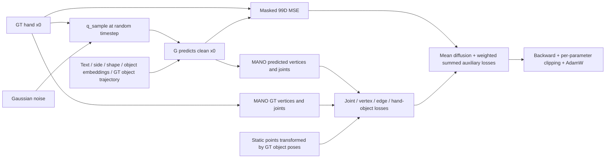

# 04 — Training pipeline and implemented losses

[Atlas home](README.md) · [Previous: architecture](03_generator_architecture.md) · [Next: inference](05_inference_and_conditioning.md)

## Executable entry point and one optimizer step

The supplied G wrapper is `script/train.sh:3–14`; it invokes `python -m oakink2_tamf.launch.train`, selects the large architecture, auxiliary loss config, reverse augmentation, static object assets, caches, and global batch size 64. It disables the expensive validation/test sampling blocks. This is a description, not a command executed for this atlas.

| Stage | Implementation and exact behavior |
|---|---|
| Register/resolve configuration | `train.main:662–672`; `reg_entry:60`. YAML merges apply to registered keys, followed by explicit command-line overrides. |
| Launch GPU workers | `train.py:674–681` validates CUDA IDs, remaps visible GPUs, and `mp.spawn`s one process per GPU. `ddp_util.setup_ddp:17` initializes NCCL even for world size one. |
| Build datasets | `train.run:334–381` loads provided pickles or constructs raw-path datasets. Reverse augmentation is passed only to training. Object point-cloud availability selects the geometry-loss point-cloud path. |
| Build samplers/loaders | Lines 386–429 divide global batch by world size (floor if not divisible), use a shuffled `DistributedSampler`, `drop_last=True`, custom collate, pinned memory, persistent workers. `set_epoch(epoch_id)` at 496 changes shuffling by epoch. |
| Initialize G | Lines 434–461 create `InterationSegmentMDM`, load an optional state dict with `strict=False`, report keys, wrap in DDP. CLIP is pretrained/frozen. |
| Initialize geometry loss | Lines 462–466 build `InteractionSegmentExtraLoss` with left/right MANO and GrabNet assets. This is the **G** auxiliary loss class, not R's loss class. |
| Initialize diffusion/schedule | Lines 467–468 choose 1000 cosine steps and `uniform` timestep sampler. Factory selects x0/MSE/fixed-small variance. |
| Initialize optimizer | Lines 469–479 use AdamW, learning rate `1e-4`, weight decay `0.0`, optional optimizer reload, and MultiStepLR. Defaults: epochs 400, milestones 150/250, gamma 0.5 (133–160). |
| Seed RNG | Lines 485–489 set `seed+rank` **after** model initialization. A recorded runtime seed alone does not establish reproducible initial model weights. |
| Prepare minibatch | Lines 509–521 zero gradients, set training mode, move selected keys, and permute target `[B,T,99]` to `[B,99,1,T]`. CLIP's override keeps CLIP in eval. |
| Sample timestep/noise | Line 518 and `diffusion/resample.py:42–67` sample one index per example. Uniform importance weights equal one. `gaussian_diffusion.py:1128–1130` creates independent Gaussian noise. |
| Predict/reconstruct | `gaussian_diffusion.py:1146` calls G on `x_t` and unchanged conditions. Lines 1179–1182 compute masked MSE and call the extra-loss module on **predicted x0**, not `x_t`. |
| Combine/backpropagate | `train.py:525–529` averages weighted diffusion losses, adds the already-reduced extra scalar, calls `backward`. |
| Clip/update | Lines 530–532 call `clip_gradient(optimizer,0.1,2.0)`, `optimizer.step()`, then zero gradients. `net_util.py:12–14` clips **each parameter tensor separately**, not one global norm over all parameters. |
| Log/schedule/save | Lines 535–573 log current scalar losses, step the LR scheduler per epoch, and save eligible rank-zero checkpoints when `commit=True`. |



## Diffusion objective

`create_gaussian_diffusion` (`src/oakink2_tamf/model/diffusion_util.py:5–31`) selects `START_X`, `MSE`, `FIXED_SMALL`, no learned variance, no timestep rescaling, and all steps via `SpacedDiffusion`. The cosine alpha-bar function is `cos²((s+0.008)/1.008 · π/2)` (`gaussian_diffusion.py:36–40`), converted to discrete betas.

At sampled index `t`, the code corrupts the entire padded representation:

\[
x_t=\sqrt{\bar\alpha_t}\,x_0+\sqrt{1-\bar\alpha_t}\,\epsilon,
\qquad \epsilon\sim\mathcal N(0,I).
\]

This is exactly `q_sample` at `gaussian_diffusion.py:190–207`. Padding is also noised; it is excluded from the reconstruction reduction, not from attention.

For example `b` with valid length `L_b` and mask `m_bf`, `masked_l2` (163–175) implements:

\[
\ell_{\mathrm{diff},b}=
\frac{\sum_{f=1}^{T}m_{bf}\sum_{c=1}^{99}(\hat x_{bfc}-x_{bfc})^2}{99\sum_f m_{bf}},
\qquad
L_{\mathrm{diff}}=\frac1B\sum_b w_b\ell_{\mathrm{diff},b}.
\]

All 99 coordinates contribute equally to this raw-coordinate MSE: three translations, six root rotation coordinates, and 90 finger rotation coordinates. There is no separate rotation/geodesic, velocity, acceleration, or finger-curl term. The printed/logged `diffusion_loss` is `L_diff` (`train.py:525–526`), while `loss_store["loss"]` before that is per-example MSE. Uniform `w_b=1`.

## Auxiliary losses: common decoding and reduction

All five come from `src/oakink2_tamf/model/interaction_segment_extra_loss.py:85–197`, abbreviated `extra_loss.py` in the line references below. Define `J=21`, `V=778`, `E=len(vpe)`. For each example, GT and predicted representations are decoded with the **same GT shape and side** into translated MANO joints `J_fj`, vertices `V_fv`, and predicted counterparts. Normals are computed from meshes (`forward:95–116`). This uses hand pose/translation GT as the reference; betas are not learned outputs.

For any per-frame feature quantity `a_fk`, write

\[
\mathcal A_b(a)=\frac{1}{L_b K}\sum_{f,k}m_{bf}a_{bfk}.
\]

The code obtains this via `mask_coef=T/L_b` times a mean over `T` and features (`extra_loss.py:105–107`). The critical outer reduction is a **sum over B**, not a mean: it initializes scalar accumulators and adds each example's contribution inside the loop. Geometry losses additionally average over the real objects of that example. This behavior differs from both the averaged diffusion objective and R's batch-averaged loss.

### `rec_joint`: squared joint reconstruction

Implemented at `extra_loss.py:118–123`:

\[
L_{\mathrm{joint}}=\sum_b\frac1{L_b J}\sum_{f,j}m_{bf}\|\hat J_{bfj}-J_{bfj}\|_2^2.
\]

It compares all 21 world-coordinate joints, including wrist and mesh-derived fingertips. It penalizes translation/global orientation as well as articulation. Coordinates are not root-centered again after the MANO translation is added. It is differentiable through rotations and MANO, subject to numerical degeneracies in rotation decoding. It uses GT hand representation, shape, and side.

### `rec_vert`: weighted squared vertex reconstruction

Implemented at `extra_loss.py:125–136`. With asset vertex weight `a_v`:

\[
L_{\mathrm{vert}}=\sum_b\frac1{L_b V}\sum_{f,v}m_{bf}\,a_v^2\|\hat V_{bfv}-V_{bfv}\|_2^2.
\]

Weights are squared before multiplying squared XYZ distance. The denominator is **V**, not the sum of vertex weights. The same `rhand_weight.npy` buffer is applied for both sides (39–41); this implementation does not load a separate left-hand weight map. It operates on world-coordinate mesh vertices and is differentiable through the predicted hand.

### `edge_len`: absolute edge-vector reconstruction

Implemented at `extra_loss.py:82–83`, 138–144:

\[
e_{bfe}=V_{bf,i_e}-V_{bf,j_e},\qquad
L_{\mathrm{edge}}=\sum_b\frac1{3L_bE}\sum_{f,e,d}m_{bf}|\hat e_{bfed}-e_{bfed}|.
\]

Despite the loss name and comments, the code never takes an edge norm. It compares three components of **edge vectors**, using L1 error. Translation cancels, but rotating the hand changes edge vectors; it is not a pure bone/mesh length penalty. Its edge pairs come from `verts_per_edge.npy`. Absolute value has Torch subgradients at equality; otherwise the predicted path is differentiable through MANO.

### Nearest-point geometry used by `dist_h` and `dist_o`

For each real object, the loss transforms its canonical point cloud (or mesh vertices) by the **GT object pose** at every frame (`extra_loss.py:146–154`). The main G wrapper provides point clouds, so `use_pc=True` (train.py:465; script/train.sh:6). Let these transformed points be `O_fo`.

`point2point_signed` (`model/loss/chamfer_distance.py:28–64`) gets nearest-point indices from the Chamfer wrapper, gathers the actual points, and computes Euclidean norms. The inspected wrapper uses PyTorch3D KNN (`thirdparty/chamfer_distance/chamfer_distance/chamfer_distance.py:147–162`); its returned squared distances are overwritten by gathered-point calculations in TaMF:

- `h2o[f,v]`: distance from hand vertex `v` to the nearest object point. It is **unsigned here**, because no object normals are passed.
- `o2h_signed[f,p]`: nearest-hand-vertex distance times `sign(n_nearest · (O_p-V_nearest))`; negative values indicate the hand-normal side interpreted as penetration.

This sign is a nearest-vertex normal heuristic, not an exact watertight-mesh signed distance. The code also computes GT versions using GT vertices/normals.

Nearest-neighbor selection and signs/thresholds are discrete; the distance norms and gathered predicted vertices still provide piecewise gradients. Do not describe the complete interaction loss as globally smooth or expect gradients through the index selection/sign change.

### `dist_h`: hand-to-object distance-profile reconstruction

Implemented at `extra_loss.py:165–171`, with `a_v^(1/2.5)=a_v^0.4`:

\[
L_{\mathrm{dist_h}}=\sum_b\frac1{N_b}\sum_o
\frac1{L_bV}\sum_{f,v}m_{bf}a_v^{0.4}
\left|\,|\hat d^{h\to o}_{bfv}|-|d^{h\to o}_{bfv}|\,\right|.
\]

This matches predicted and GT hand-vertex distance fields to each object. It is not simply a penalty that pushes every hand vertex into contact. The inner absolute values are redundant for the unsigned values supplied by this particular call but are present in the code. It uses GT hand geometry, static object geometry, and full GT object motion.

### `dist_o`: signed object-to-hand distance-profile reconstruction

Implemented at `extra_loss.py:159–178`. For each object point, define weight `q_fp` in assignment order:

\[
q_{fp}=\begin{cases}
1.5 & \hat s_{fp}<0\\
1.0 & -0.005<s_{fp}<0.01\ \text{and}\ \hat s_{fp}\ge0\\
0.1 & \text{otherwise.}
\end{cases}
\]

Then, allowing object `o` to have `P_bo` points,

\[
L_{\mathrm{dist_o}}=\sum_b\frac1{N_b}\sum_o
\frac1{L_bP_{bo}}\sum_{f,p}m_{bf}q_{bofp}|\hat s_{bofp}-s_{bofp}|.
\]

Points near the GT hand receive full weight; other nonpenetrating points receive 0.1. Predicted negative signed distances override either case to 1.5. These are hard Boolean weight assignments with no gradient through their decisions. Distances still carry piecewise gradients to hand motion. Thresholds use the coordinate units as stored; interpreting 0.005 as 5 mm presumes meter-scale assets.

## Final objective, configuration, and logging

`config/loss_param.yml:8–13` and `extra_loss.py:183–196` give:

\[
L_{\mathrm{TaMF}}=
L_{\mathrm{diff}}+1.0L_{\mathrm{joint}}+1.0L_{\mathrm{vert}}
+0.1L_{\mathrm{edge}}+0.1L_{\mathrm{dist_h}}+1.0L_{\mathrm{dist_o}}.
\]

| Logged name | Config key under `train.loss` | Supplied weight | Representation / GT |
|---|---|---|---|
| `diffusion_loss` | No registered coefficient; added directly in trainer | 1 | Raw hand translation + 6D rotations vs clean GT |
| `rec_joint` | `coef_rec_joint_loss` | 1 | 21 decoded joints vs GT joints |
| `rec_vert` | `coef_rec_vert_loss` | 1 | 778 weighted vertices vs GT vertices |
| `edge_len` | `coef_edge_len_loss` | 0.1 | Mesh edge vectors vs GT vectors |
| `dist_h` | `coef_dist_h_loss` | 0.1 | Hand→object distances vs GT distance profile |
| `dist_o` | `coef_dist_o_loss` | 1 | Signed object→hand distances vs GT profile |

Registration is `launch/param/loss.py:15–83`; registered coefficient defaults are all zero, unlike the supplied loss YAML. A term is enabled only if its coefficient is strictly positive (`extra_loss.py:44–55`). Negative coefficients do not create a repulsion/reward term because the corresponding accumulator stays zero. Assets are loaded unconditionally in the constructor, and forward prepares MANO/normals/geometry references even if coefficients are zero, so disabling coefficients alone is not a general asset-free training mode.

Raw auxiliary values are returned in `loss_dict`; their coefficients are applied only to `loss`. `summary_extra_loss` logs the auxiliary scalar under `extra_loss` and components under `extra_loss/<name>` (`train.py:292–305`). Epoch-end console values are the last batch's values (549–556), not accumulated epoch averages.

The callback uses the same coefficients at every sampled diffusion timestep. There is no timestep/SNR weighting of the auxiliary terms. The sampler's importance weights multiply only the per-example diffusion term in `train.py:525`; the extra scalar is added separately at 527. This distinction would matter if replacing the current uniform timestep sampler.

**Scaling consequence:** with DDP gradient averaging, the extra-loss sum on each worker is averaged across workers, while diffusion is averaged over each local batch. Thus the relative auxiliary strength depends on **per-worker batch size**, not just the YAML weights. With global batch 64 on four GPUs, the loop uses `B=16` per worker. A one-GPU run with global batch 64 changes this ratio. Preserve this behavior in the baseline; do not quietly “fix” reductions while testing curl loss.

## Checkpoint and validation behavior

Rank zero saves when commit is enabled and epoch is 0, at configured record intervals, or the final epoch (`train.py:558–573`). `save_state` strips `module.` and filters CLIP keys (`util/state_util.py:22–39`). Optimizer state is saved separately. Scheduler state, RNG state, and a resume epoch are not saved by that block; optional model/optimizer reload does not itself resume the loop's epoch counter or scheduler history.

The built-in validation/test blocks perform reverse sampling but do not calculate CR/SIV/PSKL-J/FID or save a validation scalar (`train.py:577–656`). They omit `obj_traj` from selected device-transfer keys (597,637); `map_copy_select_to` retains it on CPU, which is inconsistent with the GPU object projection. This is a static device-path defect to validate if enabling these blocks. The supplied wrapper disables both. `persistent_workers=True` is unconditional in this G trainer, so `num_worker=0` also needs a separate compatibility check; the encoder trainer handles it differently.

## Exact safe extension point for a curl loss

The existing extension interface is already present:

```python
# src/oakink2_tamf/model/diffusion/gaussian_diffusion.py:1181–1182
if loss_callback is not None:
    extra_loss, extra_loss_dict = loss_callback(model_output, batch)
```

Use `InteractionSegmentExtraLoss.forward` as the new loss's integration point:

1. At lines **109–112**, predicted/GT `[T,99]` representations and decoded joints are both available with their computation graphs intact.
2. For rotation-based curl, decode `pose_repr_pred[:,3:99]` and the GT slice to `[T,16,3,3]`, then select local joints 1–15. A helper can share/return the matrices currently created in `recover_mano_from_pose_repr:65–80`; preserve its existing return contract for other callers unless intentionally expanded.
3. For joint-based curl, reuse `joints_pred`/`joints_gt` already computed at 111–112, with verified SNAP chains. Exclude padded frames before any potentially singular angle extraction: an invalid `atan2`/normalization evaluated on zero padding can produce bad gradients even if its resulting loss is later multiplied by zero.
4. Accumulate a **new** valid-frame curl scalar without changing existing accumulators; add `coef_curl_loss * loss_curl` alongside lines **183–188**; return a `curl` entry alongside **189–196**.
5. Register `train.loss.coef_curl_loss` with default zero in `launch/param/loss.py`. Prefer a separate experiment YAML rather than changing the historical baseline loss YAML.

No change to the G architecture, diffusion target, noise schedule, optimizer, or existing coefficients is necessary. Generic loss logging already handles a new entry. The coefficient-zero path should avoid even computing new curl tensors. The new reduction must be explicit—matching the existing per-example **sum** is the smallest integration change; a batch mean is also possible but requires deliberate coefficient calibration. See [07](07_research_modification_plan.md) for formulation tradeoffs and proposed tests. No loss was implemented here.
