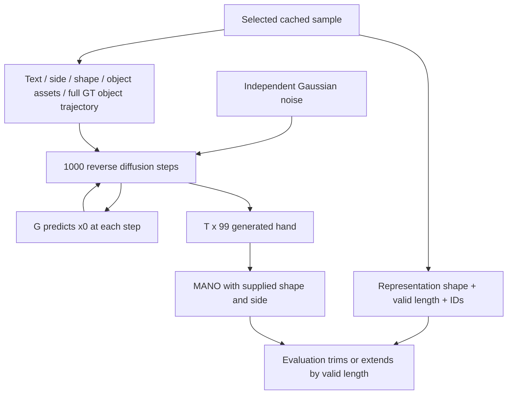

# 05 — Inference and ground-truth conditioning

[Atlas home](README.md) · [Previous: training](04_training_and_losses.md) · [Next: evaluation](06_evaluation.md)

## Original G inference, from a selected sample

The supplied wrapper `script/sample.sh:33–41` selects static object embeddings, a split/cache, a large G architecture, checkpoint, output offset, devices, and commit flag. It does not enable reverse augmentation. Its interactive shell confirmation is wrapper behavior; this atlas did not execute it.

`src/oakink2_tamf/launch/sample.py` performs:

1. `sample_worker:161–170` loads the cache and constructs `InteractionSegmentData` with object embeddings and meshes. It still needs basic toolkit metadata. Mesh loading is enabled even though G.forward does not use meshes.
2. Lines 175–196 instantiate G with config values, create 1000-step cosine diffusion, load checkpoint with `strict=False`, and log non-CLIP key mismatches. A missing-key log is not a guarantee of checkpoint compatibility.
3. Lines 198–203 assign each worker a contiguous integer range of cache indices and fetch `gt_sample=all_dataset[sample_id]`.
4. Lines 205–212 collate **one** sample and move mask, clean hand representation, shape, object count, trajectory, and embedding tensors to CUDA. Text/hand-side strings and metadata stay in the dictionary.
5. Lines 213–229 set eval/no-grad, derive `[1,99,1,T]` from the GT representation's **shape**, and call `diffusion.p_sample_loop` with `clip_denoised=False`, no initial image, no provided noise, no skipped timesteps, and no guidance callback.
6. `GaussianDiffusion.p_sample_loop_progressive` creates Gaussian noise, iterates indices 999 down to 0, and feeds the **same condition batch** to G at every step (`gaussian_diffusion.py:598–640`). G predicts x0; the posterior mean uses that x0 and current x_t (`p_mean_variance:294–310`). `p_sample` adds posterior noise except at step 0 (412–460).
7. `sample.py:230–237` converts `[1,99,1,T] → [T,99]` and saves `<sample_id:06d>.npy` under `common/sample/<exp_id>/sample/<offset>/` when commit is enabled. It saves the padded sequence, without identity metadata inside the `.npy`.

No explicit seed is registered/set by this sampling launcher. Worker/process arrangement and RNG state can therefore affect reproducibility. The cache order must remain pinned to interpret numeric filenames.



## Exactly what is supplied

| Information | Provenance in stock inference | Used by G? | Could be supplied without a GT hand sequence? |
|---|---|---|---|
| Text | Annotated primitive `seg_desc` | Yes, CLIP prefix | Yes, user text; no change to tensor dimensions |
| Hand side | Annotated involved hand | Yes, fixed side prefix | Yes, explicit side choice |
| Hand shape | GT per-frame MANO betas | Yes, temporal-mean prefix; used in reconstruction | Yes, chosen betas, but default/mean-shape quality is untested and training distribution matters |
| Object IDs / selected object set | Program hand-specific object list | Indirectly: selects assets/trajectories; strings themselves are not fed | Yes, application must define the object set |
| Static geometry embedding | Downloaded `<obj_id>.pt` | Yes, pooled prefix | Yes for known assets; extraction for novel objects is unresolved in this checkout |
| Object trajectory | Complete annotated object rigid motion | **Yes at every frame** | Must be planned/measured/supplied, or a new missing-condition policy must be trained |
| Object point clouds | Downloaded canonical geometry | No in G.forward | Needed by R/geometry metrics; not inherently GT hand motion |
| Meshes | `object_raw/align_ds` | No in G.forward; stock launcher still loads them | Asset dependency of surrounding workflow |
| Clean hand `pose_repr` | GT cache | **Values: no**; sampler uses its shape | A future launcher can allocate output shape from requested `T` instead of carrying GT pose |
| Valid length/mask/frame IDs | GT segmentation/timing | No direct G attention input | Requested duration and an output time grid can replace metadata; current workflow uses GT metadata |
| Current hand state and timestep | Random initialization and reverse process | Yes | Generated internally |

The decisive evidence is the complete set of reads in `InterationSegmentMDM.forward` (`interaction_segment_mdm.py:134–174`) and initialization arguments in `sample.py:216–229`. Carrying GT hand values in a dictionary is different from feeding them to the denoiser. Conversely, using GT object motion and shape is real conditioning dependence even without clean-hand leakage.

## Object trajectory: every conversion

| Stage | Format and processing | Evidence |
|---|---|---|
| Raw annotation | `obj_transf[obj_id][fid]`, `[4,4]`, canonical object→scene transform applied as `R p+t` | Toolkit `dataset.py:276–285`; `src/dev_fn/transform/transform_np.py:36–53` |
| Complex/primitive task | Stack frames; index enclosing primitive interval; retain only available selected objects | Toolkit `dataset.py:187–210`, 239–240 |
| Per-hand segment | Crop by offsets `seg_beg-task_beg : seg_end-task_beg` | TaMF `interaction_segment.py:32–37` |
| Temporal views/cache | Same adaptive stride and offset as hand; zero 4×4 tail to T; no interpolation, velocity, or relative-pose calculation | `interaction_segment.py:105–124`; `setment_slice.py:10–35` |
| Dataset item | Sort object IDs; extract translation `[:3,3]` and first two rows of `[:3,:3]`; concatenate into `[N_b,T,9]` | `interaction_segment.py:406–409`; `transform_np.py:159–166` |
| Batch | Zero-pad object dimension to `N`; `[B,N,T,9]` | `collate.py:41–53` |
| G frame features | Shared 9→D linear for each object/frame, ordinary object mean, `[T,B,D]` | `ObjectInputProcess.forward`, `interaction_segment_mdm.py:241–248` |
| Transformer input | Concatenate with noisy-hand frame feature, merger MLP, then temporal position encoding | `interaction_segment_mdm.py:161–171` |

Only `mask[B,T]` exists for temporal validity, and only `obj_num[B]` records object counts. **Neither is used to mask G attention or object pooling.** There is no `[B,N,T]` observation mask, no interpolation routine for sparse observations, no learned absent-trajectory embedding, and no per-object token identity pairing in the G branch.

The positions are used as stored in the annotation frame; the inspected pipeline does not subtract an object origin, center on the hand, normalize scene scale, or canonicalize global orientation. Object-count handling is flexible at the tensor level but not validity-aware. Counts in different collated batches can change pooled features; see [03](03_generator_architecture.md).

## Zero is not a missing trajectory

An actual identity pose at the origin encodes as:

```text
[tx,ty,tz, row0,      row1     ]
[0, 0, 0, 1, 0, 0, 0, 1, 0]
```

All nine zeros are **not** a valid identity rigid pose. The 6D-to-matrix converter normalizes two zero vectors into zero rows and returns a degenerate matrix (`rotation.py:462–467`). Transforming canonical points with that matrix collapses their rotated component; with zero translation, object points collapse to the origin. G does not decode these poses, but its biased linear still maps a zero vector to a nonzero learned feature. It has no way to know whether zeros mean a padded frame, padded object, corruption, or an intentionally missing observation.

Use separate concepts for (a) real object existence, (b) valid motion time, and (c) observed trajectory pose. Missing observations must be represented by an explicit observation indicator and a deliberate null feature, not by overwriting physical poses with zeros and hoping their meaning is inferred. Keeping finite placeholder poses can protect downstream geometry code, but those placeholders must never become the authoritative scene for supervision/evaluation.

## What each proposed reduction would do today

The table distinguishes **can execute with shape-preserving input changes** from **has been trained to interpret the changed input**. The latter is not established by shape compatibility. Retraining below means training/fine-tuning with the chosen corruption/availability regime; its effectiveness remains an experimental question.

| Experiment | Existing behavior / what breaks | Retraining needed for intended semantics? | Clean architectural/interface changes |
|---|---|---|---|
| Random trajectory-frame masking | Replacing selected 9D frames with zeros can execute but is ambiguous and shifts features. Adding an unused mask key has no effect. Dropping frames only from `obj_traj` changes its `T` and breaks concatenation with hand features. | Yes; inference-only masking is a robustness probe of the full-condition model. | Observation mask, mask-aware feature/null handling, shared policy. Keep hand/time axis intact. |
| Only the **first object's entire trajectory** | Slicing the object dimension to one can execute if matching embeddings/metadata are consistent. Lexicographic first object is not necessarily the main manipulated object. Zeroing all other slots leaves them in the mean. | Yes for a dedicated reduced-object regime. | Explicit object-selection policy and matching identity/embedding/traj indexing. Keep a separate full object set for losses and metrics. |
| Only the **first object's initial pose** | `[B,1,1,9]` does not match hand length T. Repeating its initial pose to T executes but communicates a stationary object, not sparse observations. | Yes; also define what happens to other objects. | Both object selection and observation-time handling. This is distinct from initial poses for all objects. |
| Sparse observed keyframes | Shape-preserving filled trajectory executes but no sparse semantics are recognized. Native sparse `[K,9]` is unsupported. Interpolating hidden frames with GT would leak unobserved information. | Yes. | Fixed-grid poses + observation mask; optionally interpolation from observed frames only. Record imputation policy and observation times. |
| Initial pose for **all** objects | Repeating each initial pose retains valid rigid poses and fits tensor shape, but asserts static motion. It supplies no indicator distinguishing future unknown frames. | Yes for a model intended to generate with initial-only observations. | Observed frame 0 only, explicit masks/null features; optional initial-pose prefix is a larger architectural choice. |
| Identity/geometry with no trajectory | Deleting `obj_traj` raises a key error. Empty N is not a null condition; zero means/empty object stacks are not supported semantics. A fixed T-shaped placeholder runs but is ambiguous. | Yes. | Fully absent-trajectory null path plus availability signal; preserve a nonempty known object set for static information. No need to change the 99D output. |
| Remove geometry embeddings | Deleting `obj_embedding` raises a key error. Disabling the dataset asset path removes the key and breaks G. Supplying zero `[B,N,768]` yields the projection bias as prefix. | Yes for a learned no-geometry regime. | Explicit geometry availability/null token. Decide whether retain object identity, count, point clouds elsewhere. Removing PointBERT assets alone does not remove all geometry from an R pipeline. |
| Remove multiple signals | Missing required keys break forward. Shape-preserving zeros/empty strings can execute, but combined absence was not taught by the stock trainer. Empty text still has CLIP start/end tokens and is not a zero text feature. | Yes, with joint availability regimes represented during training. | Configured joint policy, independent availability flags/null embeddings, explicit minimum conditions (e.g., side, chosen shape, text, duration). |

These conclusions follow `interaction_segment_mdm.py:145–165`, 241–262, `collate.py:41–53`, and dataset's empty-object skip at `interaction_segment.py:88–90`; no such experiments were executed.

## Training masks versus inference masks

Masking only at inference changes the input distribution of a model trained with full trajectories. It can measure sensitivity, but cannot establish the achievable quality of a model trained for sparse or absent trajectories. The existing `mask_cond` is text-only and defaults off; it does not train robustness to missing object conditions (`interaction_segment_mdm.py:47`, 99–109, 146).

For intended reduced-condition models, training and inference must agree on observation selection, null representation, time grid, object subset, and which signals can co-occur. Draw a training observation mask once per training example/step and hold the inference observation mask fixed across **all diffusion steps**. Independently resampling a mask every reverse step would define a different stochastic sampling procedure.

The clean GT target, loss mask, GT shape for reconstruction, and full GT object scene should remain available for supervision even when they are hidden from G's conditioning view. In particular, the current callback reads the **same batch** as G (`gaussian_diffusion.py:1181–1182`), and `InteractionSegmentExtraLoss.forward:104,150–154` decodes `batch["obj_traj"]` into geometry. Overwriting it changes what the distance losses supervise. Merely cloning the dictionary is insufficient if the trajectory tensor is edited in place through a shared reference.

## R-stage and end-to-end dependence

R takes saved G motion as `sample_pose_repr`, reconstructs hand geometry, computes distances to objects at full supplied trajectories, and predicts a residual correction (`segment_refine_model.py:170–217`). It has shape, side, static embedding prefixes and trajectory/distance frame features; it has no text/timestep prefix.

Its returned refined representation is formed **before** the GT-hand target branch. However, `forward` still decodes `batch["pose_repr"]` under `no_grad` to return training target geometry (226–243). Thus GT hand values do not determine the already-created `refine_pose_repr`, but the current R API still requires a target field even at inference. A future target-free refiner interface would need that branch separated or made optional.

Leaving R fully conditioned on GT object motion after reducing G's trajectory conditioning can restore information downstream. Report G-only results first; label any full-trajectory R results separately. Claiming reduced **end-to-end** GT dependence requires auditing/retraining R's trajectory and distance-feature paths as well. Its loss targets may retain full GT geometry for supervision, but its inference features may not.

## Remaining inference uncertainties

No novel-object embedding generation pipeline, default deployment hand-shape policy, sparse-pose observation protocol, requested-duration interface, or reproducible per-sample RNG seed is defined in the main G sampling script. The exact real-world quality impact of missing conditions is unresolved until controlled experiments. [07](07_research_modification_plan.md) proposes interfaces without treating those unknowns as already solved.
