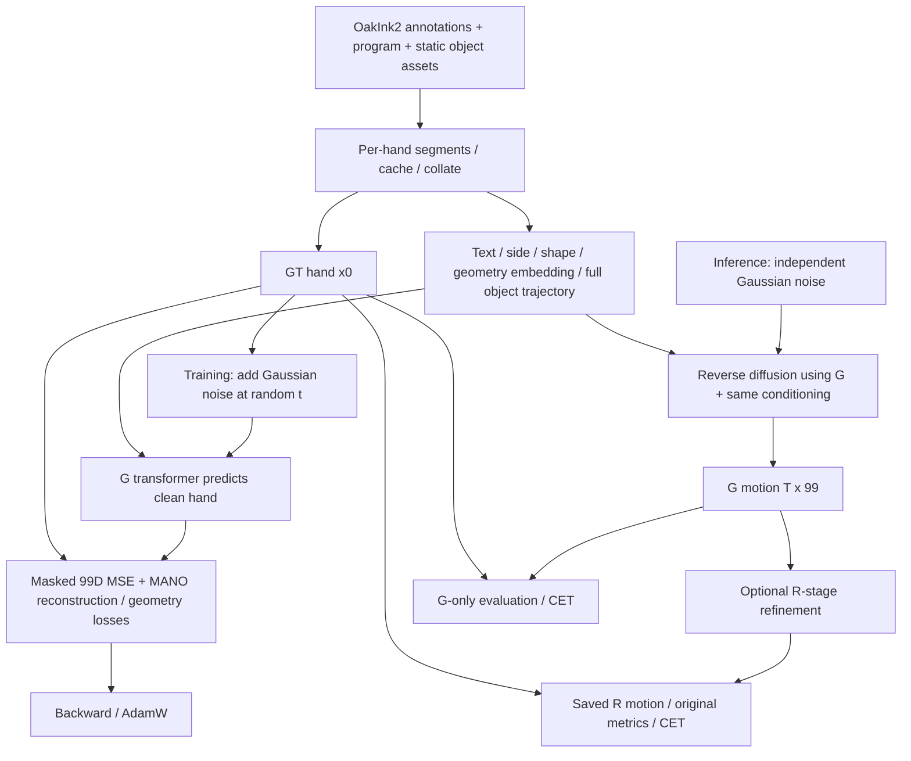

# OakInk2-TaMF codebase atlas

This atlas explains the inspected **G-stage implementation**, its data and losses, the higher-level R-stage, and concrete research extension points. It is based on repository source and small read-only asset/metadata inspections on **2026-10-13**, at root HEAD `4cb9c461b92c032715374bd252c7179c70a14bde` with pre-existing local edits. Source references use repository-relative paths and one-based lines. Proposed research changes are labeled as proposals; no implementation changes are included.

## Read the atlas

| Document | What it answers |
|---|---|
| [01 — Repository map](01_repository_map.md) | Responsibilities, callers, dependencies, configuration/assets, overall architecture |
| [02 — Complete data flow](02_data_flow.md) | Raw files→primitive/hand segments→cache→batch→model; every input's shape/provenance; reverse augmentation |
| [03 — Generator architecture](03_generator_architecture.md) | Five prefix tokens, trajectory fusion, CLIP, transformer shapes, x0 output, MANO conversion |
| [04 — Training and losses](04_training_and_losses.md) | Complete optimizer step, exact six loss formulas/weights/reductions, curl hook |
| [05 — Inference and conditioning](05_inference_and_conditioning.md) | What uses GT, object-pose conversion, missing-condition failure modes, training/inference consistency |
| [06 — Evaluation](06_evaluation.md) | CR/SIV/PSKL-J/FID implementation and sample selection; existing independent CET and its data pairing |
| [07 — Research modification plan](07_research_modification_plan.md) | Curl alternatives, default-preserving conditioning design, files/functions affected, risks/tests/fair comparisons |

For a first read, use 02→03→04→05, then 06→07. Keep 01 as a navigation reference.

## How TaMF works

The loader converts OakInk2 primitive tasks into **single-hand** motion segments. Each target frame is 99 numbers: wrist translation plus sixteen 6D MANO rotations. The G-stage trains a transformer to reconstruct this clean representation from a noisy version. It receives five prefix tokens—diffusion step, CLIP text, hand side, hand shape, and pooled object geometry embedding—and framewise object-pose features merged with the noisy hand features. The factory selects x0 prediction and a 1,000-step cosine diffusion process (`src/oakink2_tamf/model/diffusion_util.py:5–31`; `interaction_segment_mdm.py:134–174`).

At inference, G starts from random noise. It does **not** read the values of the clean GT hand motion, though the stock launcher carries those values and uses their shape. It still receives the complete GT object trajectories, dataset hand shape/side, annotated text/object selection, and GT-derived evaluation duration. MANO decodes the generated rotations and supplied shape into hands. R is a separate residual transformer using generated hands and hand–object geometry (`segment_refine_model.py:170–217`).

## Most important functions to examine

| Function | Location | Reason to read it |
|---|---|---|
| `OakInk2__Dataset.instantiate_complex_task` | `thirdparty/OakInk2/src/oakink2_toolkit/dataset.py:216` | Raw annotation schema/collection |
| `OakInk2__Dataset.instantiate_primitive_task` | Same file:155 | Enclosing versus hand-specific frame ranges |
| `InteractionSegmentData.load_dataset` | `src/oakink2_tamf/dataset/interaction_segment.py:56` | Primitive/hand extraction and synchronized slicing |
| `segment_slice_from_gap` | `src/oakink2_tamf/dataset/setment_slice.py:10` | Adaptive stride, offsets, padding |
| `InteractionSegmentData.load_reverse_segment` | `interaction_segment.py:160` | Time reversal and unchanged text/identity |
| `InteractionSegmentData.__getitem__` | `interaction_segment.py:389` | 99D hand and 9D object tensors |
| `interaction_segment_collate` | `src/oakink2_tamf/dataset/collate.py:33` | Object padding and metadata lists |
| `InterationSegmentMDM.forward` | `src/oakink2_tamf/model/interaction_segment_mdm.py:134` | Complete G forward pass |
| `InterationSegmentMDM.encode_text` | Same file:111 | CLIP token truncation/encoding |
| `ObjectInputProcess.forward` | Same file:241 | Trajectory pooling and masking extension point |
| `ObjectEmbedProcess.forward` | Same file:258 | Static geometry pooling |
| `create_gaussian_diffusion` | `src/oakink2_tamf/model/diffusion_util.py:5` | x0/MSE/fixed variance choices |
| `GaussianDiffusion.training_losses` | `src/oakink2_tamf/model/diffusion/gaussian_diffusion.py:1106` | Noise, prediction, loss callback |
| `InteractionSegmentExtraLoss.forward` | `src/oakink2_tamf/model/interaction_segment_extra_loss.py:85` | All five G auxiliary losses and proposed curl hook |
| `InteractionSegmentExtraLoss.recover_mano_from_pose_repr` | Same file:65 | Rotation/shape→vertices/joints |
| `train.run` | `src/oakink2_tamf/launch/train.py:308` | Optimizer step and checkpoint lifecycle |
| `sample.sample_worker` | `src/oakink2_tamf/launch/sample.py:146` | Actual inference inputs, random initialization, numeric output IDs |
| `SegmentRefineModel.forward` | `src/oakink2_tamf/model/segment_refine_model.py:170` | R geometry features and residual output |
| `SegmentEncoder.forward` | `src/oakink2_tamf/model/segment_encoder.py:75` | FID's learned motion/context feature |
| `curl_from_local_rotations` / `constrained_dtw` | `Scripts/evaluate_cet.py:95`,163 | Existing local articulation metric and time alignment |

Repeated basenames in this table refer to the preceding complete path in their group. Metric entry points and formulas are mapped separately in [06](06_evaluation.md).

## Primary research extension points

**Finger-curl loss:** add a separately weighted differentiable term in `InteractionSegmentExtraLoss.forward:109–112,183–196`; register a default-zero coefficient in `src/oakink2_tamf/launch/param/loss.py:15`; keep a new experiment YAML separate from the original loss config. Predicted/GT 16 local rotation matrices can be decoded directly, or the already reconstructed 21-joint tensors reused. Exclude root and verify MANO versus SNAP ordering. Existing generic logging needs no special case. [04](04_training_and_losses.md) identifies exact hooks; [07](07_research_modification_plan.md) compares formulations.

**Conditioning masks:** prepare a dedicated view in `train.run:512–524` and `sample_worker:203–229`, use it in `InterationSegmentMDM.forward:145–165`, and add explicit observation/null handling in `ObjectInputProcess.forward:241–248` and `ObjectEmbedProcess.forward:258–263`. Register shared configuration in both launchers. Keep full GT object transforms in the original supervision batch: the existing geometry loss uses `batch["obj_traj"]`. An observation mask must be distinct from `mask` (valid time) and object-slot validity. [05](05_inference_and_conditioning.md) covers scenarios; [07](07_research_modification_plan.md) gives the implementation matrix.

## Findings and technical risks to retain

| Finding / uncertainty | Consequence |
|---|---|
| x0 prediction, not epsilon prediction | Curl/geometry callback already receives a clean-hand estimate. |
| Object count is flexible but pooling ignores slot validity | A sample's condition features depend on batch maximum object count. Fixing pooling changes the baseline. |
| Shape averages zero padding; G has no attention padding mask | Duration/padding can influence prefixes and valid-frame outputs. |
| Object identities and trajectories are independently averaged | No explicit geometry-to-trajectory binding per object. |
| `edge_len` compares vectors; G extras sum local batch while diffusion averages | Loss names/weights alone do not describe actual semantics/scaling. |
| Reverse augmentation retains descriptions and info keys | Temporal reversal can conflict with language; metrics discard repeated info keys. |
| Cache contents override split expectations | Cache identity/order must be pinned; split flags do not filter loaded caches. |
| Original metrics use first-info selection and silently skip missing records | Their evaluated population differs from all generator slices; coverage must be recorded. |
| FID encoder is never put in eval mode | Dropout is active in the current evaluator; deterministic comparison needs a versioned repair. |
| SIV appears to double-add mesh center and uses a grid-spacing approximation | Audit/version before interpreting precise volumes; no correction was made. |
| FID encoder's output head uses 99 rather than 69 action classes | Feature extraction is pre-head, but the training wiring deserves explicit documentation. |
| G built-in val/test transfer omits object trajectory; persistent workers unconditional | Enabling dormant trainer paths needs device/worker checks; standard wrapper disables sampling blocks. |
| Released embedding/point-cloud generation scripts absent | Exact extraction normalization/checkpoint/sampling provenance remains unresolved. |
| Dependency revisions and installed-module resolution are separate provenance | The inspected Chamfer source uses PyTorch3D KNN; the activated environment's import path was not probed. |
| Existing CET is a partial-batch G/R-paired evaluator | It already implements local bend+DTW, but its coverage is not automatically full-test/G-only. |
| Raw annotation units/frame-index conventions not exhaustively audited | Coordinates are used as stored; threshold interpretation and novel dataset import need checks. |
| No numerical experiments were authorized/run | Quality effects of missing conditions, curl formulations, and metric concerns remain unmeasured. |

The source evidence and precise limits for these findings are in documents 02–06. Small serialization headers confirmed an example 768D embedding and 8192-point object cloud; this is not a full asset-integrity audit.

## Recommended next implementation order

1. Pin the current code/assets/cache/sample-ID manifest and establish small synthetic representation/gradient fixtures. Keep metric repairs in an independently versioned change.
2. **First model-training code modification:** add default-off curl-loss plumbing in `InteractionSegmentExtraLoss` and its config registry. Validate coefficient-zero scalar/gradient equivalence and root-rotation invariance before any training run.
3. Compare anatomy-aligned bend supervision against a generic local-rotation control; run the curl-only experiment with unchanged original losses/local batch size.
4. Separate conditioning and supervision views, preserving exact legacy default behavior.
5. Add explicit trajectory observations/null features; train/evaluate random, sparse, initial-only, and absent-trajectory regimes with matched policies.
6. Add geometry/multiple-signal ablations; report G-only and optional R separately, with identical paired populations and reproducible sampling.
7. Extend R and/or differentiable temporal alignment only after independent contributions are understood.

The atlas contains documentation only. Existing source files, configurations, weights, and data were left unchanged.
