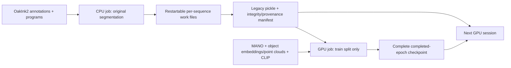

# Cached preprocessing and epoch-boundary training

This workflow is for the G-stage generator. It preserves its 99D motion, object
conditioning, diffusion objective and existing CET implementation. It does not
change the refiner/encoder launchers. Run Linux commands in WSL locally and in
the activated `oakink2-tamf` environment on Shenkar.



## What caused the memory failure

The pre-change launcher at baseline commit `72f7a29` constructed train, val and
test on rank zero (`launch/train.py:334–381`), but checked disabled evaluation
frequencies only inside the epoch loop (`579–621`). All three eager datasets
remained resident. DataLoader workers did not cause the *reported construction*
OOM, because workers start when the loaders are iterated; they are an additional
risk once training begins.

`InteractionSegmentData.load_dataset` retains padded rotation matrices,
translations, shapes, object transforms and metadata for all segments.
`SegmentSlice.from_gap` takes every temporal offset, not just one decimated
sequence. This behavior is preserved. `collect_mano` uses boolean indexing and
float32 conversions; the OakInk toolkit also materializes the current complete
sequence and all its primitive tensors. These are temporary allocations, not a
permanent cache of every raw sequence. Some full-length slices retain views of
their derived primitive arrays. Padding allocates new arrays.

For 70,564 **base** segments, hand arrays alone occupy about 6.60 GiB; each object
trajectory per sample adds about 0.67 GiB across that population. Eager reverse
augmentation copies those arrays again. Python objects and transient raw data
increase the peak. Check whether the failed job's 70,564 count already included
augmentation before applying this estimate. Its MaxRSS was approximately
16 GiB, consistent with its 16G CPU-memory allocation, irrespective of node RAM.

The existing pickle is an eager RAM cache: it saves segmentation time, not
corpus-sized training RAM. Memory mapping it directly is not supported. This
version reduces RAM by skipping disabled splits, using virtual reverse samples,
and starting with zero DataLoader workers. Each DDP rank still holds its own
base cache. A lazy storage backend is deferred until measurements justify it.

## Portable paths and environment

Set these variables to actual locations; no local Windows/WSL path is embedded
in the implementation:

```bash
export REPO_ROOT=/absolute/path/to/OakInk2-TaMF
export DATA_ROOT=/absolute/path/to/OakInk2/data
export CACHE_ROOT=/persistent/path/to/tamf_cache_v1
export LOG_ROOT=/persistent/path/to/job_logs
cd "$REPO_ROOT"
mkdir -p "$CACHE_ROOT" "$LOG_ROOT"
```

Activate the existing environment. For batch jobs, either export `CONDA_BASE`
(the installation root) and optionally `TAMF_CONDA_ENV`, or provide an executable
`TAMF_PYTHON`. Shell templates do not assume a Conda installation path. Ensure
submodules and existing MANO/CLIP/object assets are installed; this workflow does
not download them. GPU IDs are logical indices within Slurm's existing
`CUDA_VISIBLE_DEVICES` mask, including UUID/MIG masks.

## Inspect, preprocess once, and verify

Check existing candidates first:

```bash
find "$CACHE_ROOT" "$REPO_ROOT/common/save_cache_dict" -type f -name '*.pkl'
```

Validate a selected existing cache without writing anything:

```bash
python -m script.save_cache_dict \
  --data.data_prefix "$DATA_ROOT" \
  --data.process_range "?(file:$REPO_ROOT/asset/split/train.txt)" \
  --data.split_name train \
  --cache.output_filepath "$CACHE_ROOT/train.pkl" \
  --cache.verify_only
```

Build only when no compatible output is already present:

```bash
CUDA_VISIBLE_DEVICES="" python -u -m script.save_cache_dict \
  --data.data_prefix "$DATA_ROOT" \
  --data.process_range "?(file:$REPO_ROOT/asset/split/train.txt)" \
  --data.split_name train \
  --cache.output_filepath "$CACHE_ROOT/train.pkl" \
  --cache.resume --commit
```

This command first validates/reuses a compatible existing output without raw
preprocessing. Otherwise it processes one sequence at a time using the original
loader, without meshes, embeddings, point clouds or reverse augmentation. It
logs sequence progress and Linux RSS/high-water marks. The final cache retains
the original ten dictionary fields and transformations. Object assets are
loaded separately at training time, as before.

`train.pkl.work/` retains completed sequence pickles and their manifests. A
restart validates and reuses them. Final assembly still loads the complete
split into memory; it extends lists without copying their numeric arrays. Disk
usage is approximately one set of work shards plus one final cache, with
additional incomplete attempts possible. This implementation never prunes work
files or checkpoints automatically.

`train.pkl.manifest.json` records ordered split identifiers, slicing settings,
unaugmented status, source fingerprints, count, size and SHA-256. Source hashes
normalize CRLF/LF for cross-platform checkouts. Cached bytes and structure are
checked before use; source annotation *content* is not independently hashed.
If annotations/programs change, use a new cache identity/output location.

Legacy caches without a manifest can be structurally validated and used with
the normal legacy training path, which warns about unknown provenance. They
cannot be silently declared equivalent or overwritten by the builder. Strict
training requires a manifest. Establish provenance/equivalence before deciding
to adopt an old cache; no automatic adoption is implemented.

Publication uses an atomic, no-clobber hard link on the destination filesystem.
Verify hard-link support on Shenkar's persistent storage. A checksum failure,
incompatible manifest, or completed pickle with a missing sidecar fails safely;
it does not trigger raw preprocessing or overwrite the artifact. Incomplete
sequence attempts without manifests are preserved and retried under new names.
A final-pickle publication interrupted before its sidecar needs review; this
version deliberately does not guess its provenance.

For optional validation/testing caches, replace **both** the split filename and
`--data.split_name`; never use an all-split cache as a training-only cache.
Full-split preprocessing has not been run during this change.

## Start and resume training

Use a complete reviewed experiment YAML containing the existing model, loss,
geometry/embedding paths, reverse setting, batch size and intended CET weight.
`config/cet_smoke.yml` uses 0.1 for smoke testing only; it does not select the
research coefficient. Relative asset paths are resolved from the checkout.

```bash
export EXPERIMENT_CONFIG=/absolute/path/to/reviewed_experiment.yml
export EXPERIMENT_ID=cet_experiment_001
python -u -m oakink2_tamf.launch.train \
  --cfg "$EXPERIMENT_CONFIG" \
  --data.data_prefix "$DATA_ROOT" \
  --train.cache_dict_filepath "$CACHE_ROOT/train.pkl" \
  --train.require_verified_cache \
  --train.record_freq 1 \
  --runtime.num_worker 0 --runtime.device_id 0 \
  --val.val_freq -1 --test.test_freq -1 \
  --exp_id "$EXPERIMENT_ID" --commit
```

Disabled splits are not opened or constructed. Missing/incompatible strict
caches fail; there is no fallback to raw segmentation. Positive evaluation
frequencies continue to load their respective splits on rank zero. Evaluation
now transfers object trajectories and uses the unwrapped model to avoid
rank-zero-only DDP forward collectives. Normal diffusion sampling is unchanged.

Reverse augmentation presents originals followed by reversed samples, matching
the original values/order/masks/frame IDs while allocating reversed arrays per
access instead of for the whole corpus. Public eager augmentation remains
available to other callers. Cached datasets without mesh requests no longer
instantiate the raw toolkit. Point clouds can make meshes unnecessary, but
this workflow does not silently change the experiment's `enable_obj_model` flag.

To resume, repeat the command with the same ID/config and add:

```bash
--train.resume_checkpoint latest
```

An explicit full-state path is also accepted. `--train.num_epoch` remains the
**total target**, not the number of additional epochs. You may increase it.
Fresh committed runs refuse an existing nonempty experiment directory.

Complete states live in `common/train/$EXPERIMENT_ID/save/state_epoch_*.pt` with
checksum manifests. `latest` selects the newest complete valid state, warning
when skipping incomplete/corrupt candidates. Full states contain generator,
optimizer, scheduler, completed/next epoch, update/log counters, per-rank RNG and
loader generator states, and data/object/MANO/CLIP-loader/objective identities.
Frozen CLIP is recreated through its original checksum-validating loader, not
duplicated in checkpoints. Legacy `model_NNNN.pt`/`optimizer_NNNN.pt` exports
remain available. Snapshot files are never overwritten. Logs/options use unique
session directories, preserving earlier sessions.

Model/data/assets/loss/batch/world-size/worker/scheduler changes reject complete
resume. Existing `reload_ckpt_*` flags remain **warm starts**, not full resume,
and cannot be combined with the new flag. Complete resume requires a persistent
training cache. Fresh model initialization is now seeded before construction;
previously unseeded initialization is not promised to reproduce bit-for-bit.

Checkpointing occurs after scheduler advancement and enabled evaluation, so RNG
continuation includes evaluation. The current uniform diffusion timestep
sampler has no learned history. No AMP scaler or gradient accumulation exists
in this launcher. CET and all existing loss reductions remain unchanged.

**Epoch boundaries only:** a killed partial epoch is repeated from the last
completed checkpoint. `SIGKILL`/OOM cannot be caught. `SIGUSR1` requests stopping
after the current complete epoch, including enabled evaluation. Optional
`--runtime.max_seconds` checks at boundaries whether another epoch is likely to
fit, using 1.25 times the observed duration plus a ten-minute reserve. It cannot
guarantee that the first epoch fits. Benchmark before a long job; if an epoch
exceeds the confirmed allocation, stop and revisit mid-epoch resumption.

## Bounded local tests and later GPU smoke

```bash
CUDA_VISIBLE_DEVICES="" OMP_NUM_THREADS=1 MKL_NUM_THREADS=1 \
  python -m unittest discover -s tests -p 'test_*.py' -v
```

Tests use temporary synthetic caches and small CPU models. Raw/cache equivalence
reuses actual collection/slicing/conversion code with synthetic raw I/O. The
launcher test uses real diffusion/AdamW and CPU model/loss substitutes, not a
TaMF generator. CPU/Gloo tests do not verify NCCL or the server's PyTorch build.

Prepare a bounded subset from a verified training cache in a CPU session
(loading the source pickle still requires its full RAM):

```bash
python -m script.debug.smoke_cached_training --prepare-only \
  --source-cache "$CACHE_ROOT/train.pkl" \
  --cache "$CACHE_ROOT/smoke_subset.pkl" --sample-indices 0 1
```

Then explicitly run the real generator/CET checkpoint smoke on an allocated GPU:

```bash
python -m script.debug.smoke_cached_training --run-gpu-smoke \
  --cache "$CACHE_ROOT/smoke_subset.pkl" --data-prefix "$DATA_ROOT"
```

This is capped at four unaugmented samples, batch size one and two one-epoch
sessions. It uses CET weight 0.1 only for validation, checks restored counters,
weight updates, finite weights/loss logs and CET diagnostic tags, and saves into
new UUID experiment/control directories. It never performs raw preprocessing or
motion sampling. Extra `--cfg` overlays can supply portable asset paths. This
real-generator smoke is implemented but has **not** been run for this change.

## Slurm templates — provisional until server validation

`script/slurm/preprocess.sbatch` and `script/slurm/train_cached.sbatch` take paths
from exported variables. They deliberately contain no fixed partition, GRES or
wall-time directives. The following allocations are examples to validate, not
confirmed Shenkar limits:

```bash
# Export the path/environment variables first; ensure LOG_ROOT already exists.
sbatch --partition="$CPU_PARTITION" --cpus-per-task=4 --mem=32G \
  --time=02:00:00 --output="$LOG_ROOT/preprocess-%j.out" \
  script/slurm/preprocess.sbatch

sbatch --partition="$GPU_PARTITION" --nodelist=slurm-gpu \
  --gres=shard:1 --cpus-per-task=4 --mem=32G --time=04:00:00 \
  --signal=B:USR1@600 --output="$LOG_ROOT/train-%j.out" \
  script/slurm/train_cached.sbatch
```

For subsequent jobs, export `RESUME_CHECKPOINT=latest` before submission. Unset
it for a new experiment. Optionally set `SESSION_MAX_SECONDS` from the confirmed
allocation (for example, 13800 for a confirmed four-hour job). Validate that
direct Python execution inside the batch allocation is permitted on the site.
The shell forwards USR1 only to the launcher parent and preserves its exit code;
the parent shares the stop request with spawned training ranks. The template
uses a job-derived rendezvous port unless `MASTER_PORT` is supplied; check for
port conflicts when running concurrent jobs. Do not launch overlapping jobs for
the same experiment ID.

Start with 32 GB for CPU preprocessing and single-GPU, zero-worker cached
training; this is an estimate. Measure actual peaks and raise to 64 GB if usage
approaches 24 GB or other evidence warrants it. GPU VRAM is a separate measure.
Work shards and immutable checkpoints consume disk; there is no automatic
retention/deletion policy. A full generator/Adam checkpoint can occupy several
hundred MB, so budget persistent storage before repeated sessions.

```bash
squeue -j "$JOB_ID"
sstat -j "${JOB_ID}.batch" --format=JobID,MaxRSS,AveRSS
sacct -j "$JOB_ID" --format=JobID,State,ExitCode,ReqMem,MaxRSS,Elapsed
tail -f "$LOG_ROOT/train-${JOB_ID}.out"
```

Inspect both job and step rows: a per-process MaxRSS can understate aggregate
worker/rank usage. Linux process RSS is logged; no portable cgroup aggregate
reader is implemented. Use the cluster's accounting for allocation decisions.

### Required Shenkar verification

1. Confirm checkout/data/asset/cache paths, permissions and persistent storage.
2. Inventory/validate existing caches before approving new full preprocessing.
3. Confirm Python 3.10.21/PyTorch 2.0.1+cu118 imports and rerun lightweight tests.
4. Verify cache/checkpoint no-clobber hard-link publication on persistent storage.
5. Confirm partitions, actual session limits, GRES/shard meaning, GPU visibility,
   CPU/RAM policy, rendezvous networking and direct batch Python execution.
6. Run the bounded real-generator/CET two-session smoke and inspect diagnostics.
7. Validate signal forwarding and completed-epoch shutdown in a small Slurm job.
8. Measure full-cache RAM and representative batch/epoch timing before deciding
   whether epoch-boundary resumption is sufficient. Check NCCL/multiple GPUs if used.
9. Approve full CPU preprocessing only if no compatible cache exists; approve a
   long training job separately after the timing/storage checks.

Local entry-point/fixture tests verify command syntax and control flow, not full
dataset or Slurm execution. The local WSL environment is PyTorch 1.13.0+cu116,
so server-version verification remains necessary. No full preprocessing,
generator training, Slurm submission, downloads, commits or pushes were run as
part of this implementation.
